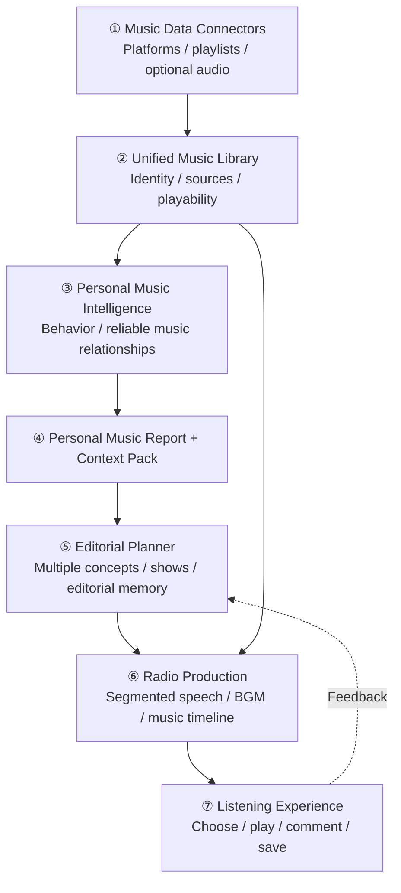

# AI Music Radio

English | [简体中文](README.zh-CN.md)

**Your Music. More to Discover. — A story worth hearing behind the music you already love.**

AI Music Radio is a **personal music intelligence and narrated radio experience** built from the listener's everyday music data: saved songs, playlists, play counts, dates added, and optionally recordings they control. It learns the shape of an existing music world, explains verifiable relationships between artists, works and eras, then curates narrated programs that connect familiar songs to unfamiliar stories.

The premise is **not just “you like A, therefore play B.”** It is “you know A—here is a surprising, well-supported relationship to another musician, period or recording, and a story worth exploring through listening.”

**Current state: product definition and reuse research.** No real library import, Music Assistant integration, finished episode or working UI has been validated in this repository. [Current status](docs/STATUS.md).

## 1. What problem are we solving?

Streaming services are already excellent at recommending what to play next and offer daily mixes, single-track radio, mood stations and annual listening reports. However, they rarely turn the listener's accumulated music history into a coherent, inspectable, evolving story.

- **Personal music data is underused.** Favorites, playlists, cumulative plays and collection dates document someone's listening life, but are mostly used to rank another track. Entertaining annual reports are often difficult to interrogate.
- **Recommendations rarely explain why a musical relationship matters.** Someone may need more than a similar-sounding song: they may want to know who played together, how a style evolved, or what connects several artists already in their collection.
- **Music knowledge is rarely personalized.** A skilled radio host can make an artist's story compelling but cannot know each listener's collection. A generic LLM may know music history but not where to begin for a particular person.
- **Discovery is not the same as listening.** During a commute, drive or household task, the listener wants a well-produced journey, not another graph they must study or a playlist they must construct.

**Opportunity:** familiar music is the bridge to new knowledge. Let AI act as an editorial team that understands its listener, grounds its research, offers choices and continually produces engaging radio stories.

## 2. One product, three checkpoints

| Checkpoint | Value to the listener | Result |
| --- | --- | --- |
| **01 · Connect My Music** | Bring in an existing music world | Imported catalog, playlists, favorites and listening statistics, with source coverage |
| **02 · Understand My Music** | Discover evidence-backed patterns and meaningful connections | **Personal Music Report**, musician/work relations, exploration paths |
| **03 · Tell My Radio Stories** | Hear music and its context as a coherent, narrated program | Several episode proposals, modular 15–20-minute timelines, feedback and continuations |

**Checkpoint 01 — Connect.** Accept data from authorized sources such as Apple Music, Spotify, YouTube Music, NetEase Cloud Music, QQ Music, owned files or existing music libraries. An initial import may be an exported catalog, so raw audio uploads are **not a prerequisite**. Preserve track/artist/release identities, playlists, favorite status, **original Play Count and Date Added**, along with coverage and missingness. Different providers' metrics must not silently be treated as equivalent.

**Checkpoint 02 — Understand.** The Personal Music Report should answer useful questions: Which artists and works form persistent centers of this collection? Which recently repeated songs are transient spikes rather than long-standing interests? What documented collaborations, cover relationships, genres and eras connect items the listener already knows? Which path leads naturally toward unknown music? Insights should be traceable to user data or musical evidence, with uncertainty and correction where needed—not personality astrology.

**Checkpoint 03 — Tell stories.** The editor can prepare multiple ideas: continue an unfinished musical thread, explore recent listening, or follow an unexpected connection. The user may instead start from a track, artist, genre, mood or explicit question, or delegate the choice. An initial target is an adjustable **15–20-minute program**. Intro, narration chapters, transitions, song items and ending are separate modules. Feedback like “focus more on musician relationships” should re-plan relevant sections and rerender affected voice clips, not automatically reproduce the whole show. Finished programs may be saved; interesting unresolved threads can inspire future episodes.

**Music metadata, music knowledge and music playback are different capabilities.** A catalog-only source can inform reports and show outlines. Commercial recordings are playable only through independently authorized sources; subscription access does not authorize capturing, cutting or remixing DRM-protected audio.

## 3. An end-to-end listener journey

1. **Connect once:** the listener authorizes an existing catalog or playlist export. The product displays imported tracks, observed play counts and dates added, missing fields and sources. A conversation about personally pivotal songs is optional, never required onboarding.
2. **Discover a personal music world:** the home view shows a concise Music Report—long-term patterns, recent listening changes and grounded links. Facts and sources can be inspected.
3. **Choose a story:** the AI prepares a few editorial choices. The listener can also create a station from a single recording, select a mood/genre, or ask for a historical introduction starting from known works.
4. **Plan, then render:** the editor selects a narrative, evidence, track sequence, rights and duration before creating independent speech/TTS segments. Songs remain separate authorized playback items.
5. **Listen and respond:** the player shows current music, story theme, next-track reason, play/skip/save and a simple editorial comment. Future shows may reuse unresolved threads without forcing serial listening.

Three overlapping user jobs support this experience: **Music Owner (collection curator), Music Explorer (active discoverer), Radio Listener (lean-back audience)**. See [personas and journeys](docs/01-product-overview.md).

## 4. Product modules and major responsibilities

| Module | Responsibility and output | Reuse/build direction |
| --- | --- | --- |
| **① Data Connectors** | Authorized source imports, original play counts, dates added and data coverage | **Build import/normalization glue**, evaluate existing exporters and connectors |
| **② Unified Music Library** | Resolve works, recordings, releases, artists, catalog IDs and lawful playable sources | **Reuse Music Assistant** library and provider capabilities where verified |
| **③ Music Intelligence** | Listening behavior, verified musical knowledge, explainable relations and optional acoustic analysis | **Core additional development**; reuse available metadata and acoustic services |
| **④ Report & Context** | User-facing music insights; relevant evidence subsets for specific episodes | **Core additional development** |
| **⑤ Editorial Planner** | Candidate shows, music/history research, duration, segments and continuity | **Core additional development**, connected to the upstream AI Radio engine |
| **⑥ Radio Production** | Script, TTS, lawful BGM, authorized song playback, modular edits and timeline | **Reuse AI Radio, queues and model providers first**, extend only measured gaps |
| **⑦ Experience / UI** | Collection, report, programs, playback and comments in a coherent journey | **Test independent low-fi product UI** and existing APIs before replacing frontend |

These are **architectural intentions**, not shipped or verified capabilities. Details: [conceptual architecture](docs/04-conceptual-architecture.md).

## 5. Reusing Music Assistant—what remains different?

[Music Assistant](https://www.music-assistant.io/) is an open-source music aggregation/playback system. Its [AI Radio plugin](https://www.music-assistant.io/plugins/ai-radio/) already supplies hosts, shows, segmented voice narration and TTS. Basic AI DJ is **not** our distinctive invention.

**What to reuse first:**

- **Library and sources:** `controllers/music` and individual music `providers/*` for catalog, favorites, search and playlists where supported.
- **Playback:** `controllers/player_queues` and `controllers/streams` for queue and stream behavior under lawful provider access.
- **AI radio foundation:** `providers/ai_radio` (including `hosts.py`, `queue_dj.py`, `rendering.py`, `models.py`) for hosts, queue insertion and voice segments.
- **Model/music features:** OpenAI-compatible LLM, TTS, Smart Playlist and optional Sonic Analysis/Similarity providers.
- **Interface:** assess existing Web/PWA and API; create an independent UI only if it clearly improves the intended journey.

**The incremental value to test is not “an AI talks between songs.”** It is (1) accurate use of original play counts, dates added and playlists; (2) evidence-backed personal music reports and multi-artist music-history storytelling; (3) several genuine program choices, continuity and comment-driven **partial revisions**. We must run and inspect upstream before assuming any of these is entirely absent.

Provider support is not proof of full personal statistics, stable login, commercial redistribution rights or permission to remix tracks. Relevant sources: [Music Assistant server](https://github.com/music-assistant/server), [frontend](https://github.com/music-assistant/frontend), [AI Radio docs](https://www.music-assistant.io/plugins/ai-radio/). See the [detailed reuse audit](docs/04-conceptual-architecture.md#music-assistant-reuse-assessment).

## 6. Technical principles

**Where data and inference run is a configurable implementation choice.** Music data may be obtained from permitted online services or local files; text LLM and TTS can be explicitly configured locally or in the cloud. Tell the user which data leaves their device; never silently change providers or upload original recordings.

**Credible facts precede exciting narration.** Same title does not imply the same recording. Artist credits, covers and historical collaborations need sources. Sonic similarity or LLM inference cannot masquerade as documented artistic influence. Make missing data and confidence visible.

**Understanding is distinct from playback.** Something can be analyzed without being playable; playback access does not authorize extraction or processing of protected audio. Preserve original catalog and rights metadata.

**Preproduction and partial editing matter.** Keep the show plan, individual host segments, music slots and generated assets separate. Prepare candidate stories where useful; regenerate only affected sections and adjacent transitions when practical.

## 7. First proof of value

**Authorized personal metadata import → source-backed Music Report → multiple personal episode plans → modular script/TTS → existing playback capability where permitted.**

The first experiments must establish how complete the imported play count/date-added fields are, whether personal context improves program quality, exactly which Music Assistant functionality can be reused, and which sources can lawfully play music. Planned features remain planned until demonstrated. See [MVP acceptance](docs/02-mvp-and-requirements.md), [status](docs/STATUS.md) and [stable feature inventory](docs/PRODUCT_FUNCTIONS.md).

## 8. Interface and further documents

Initial UI work uses **monochrome, Notion-like low-fidelity layouts**: clean typography, mostly straight rules, blocks and restrained dashed annotations for AI drafts. [Wireframe guide](docs/06-lowfi-wireframes.md).

**This README is the complete product introduction.** See the [PRD](docs/PRD.md) and [2025 data-driven H5 prototype](prototype/index.html) for screen behavior and linked user data. Consult [personas and journeys](docs/01-product-overview.md) for user scenarios; [architecture](docs/04-conceptual-architecture.md) for contracts and reuse; [MVP](docs/02-mvp-and-requirements.md) for acceptance; and the [illustrative music demo](docs/03-my-back-pages-demo.md) for one particular episode rather than general product requirements.

The prototype includes only the 98 ranked song entries and play counts the user supplied and expressly requested for this public demo; it does not store the original screenshots, account identifiers, full listening histories, credentials or uncleared commercial audio. The project's own license is undecided; upstream open-source and service-provider terms apply.
