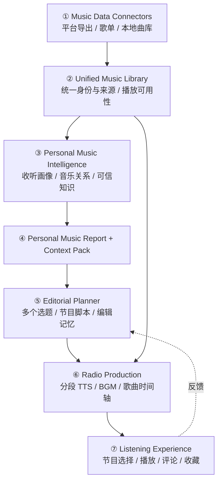

# AI Music Radio

[English](README.md) | 简体中文

**Your Music. More to Discover.｜让每天听过的音乐，拥有值得继续聆听的故事。**

AI Music Radio 是一款以**个人日常音乐数据**为起点的音乐理解与故事电台应用。它连接用户已经收藏和听过的音乐，研究这些音乐之间有依据的关联，用音乐报告呈现用户自己可能尚未注意到的审美轨迹，再策划由歌曲、主持人口播与音乐故事组成的个性化节目。

它希望带来的体验，不是简单的“你喜欢 A，因此推荐 B”，而是**“你已经熟悉 A；原来 A 与这些音乐人、年代和作品还有这样的联系。我们沿着这条线索听一段故事。”**

**当前状态：产品定义与开源复用研究阶段。** 本仓库尚未完成真实个人曲库导入、Music Assistant 联调、可播放节目或前端实现。详情见[项目状态](docs/STATUS.zh-CN.md)。

## 1. 为什么做这个产品？

音乐平台已经很擅长通过算法把用户可能喜欢的歌接着放下去，也有每日推荐、单曲电台、场景电台和年度听歌报告。但这些体验之间还有明显空缺：

- **音乐数据积累了很多，却很少被真正理解。** 收藏夹、播放次数、添加日期和歌单记录了用户的音乐经历，但往往只用于排序和重复推荐。年度报告很有趣，却不一定解释得清楚、经得起追问。
- **推荐告诉你“下一首听什么”，很少解释“为什么值得听”。** 用户不一定缺一首新歌；他可能更想知道熟悉的音乐背后有谁参与、风格从何而来、与其他收藏有什么联系。
- **音乐知识和个人兴趣脱节。** 高质量音乐节目有编辑判断、叙事与情绪感染力，但播客主持人并不知道听众究竟听过什么。通用 AI 可以介绍音乐史，却未必知道从哪个已熟悉的节点切入。
- **从发现到聆听之间还有一道门槛。** 用户在通勤、驾驶和做家务时，不想自己研究一张关系图，再逐首搜索资料、编排歌曲。

**我们的机会：把用户熟悉的音乐当作进入新知识的桥梁，让 AI 像理解听众的音乐编辑一样，持续准备有证据、有选择、有主持风格的节目。**

## 2. 用户将得到什么？

产品是一个连续的体验，而不是三个彼此独立的小工具：

| Checkpoint | 用户看到的价值 | 代表结果 |
| --- | --- | --- |
| **01 · Connect My Music** | 连接已有音乐世界，不从零建立兴趣档案 | 已导入曲库、歌单、收藏、播放统计和来源覆盖 |
| **02 · Understand My Music** | 对收藏和听歌行为做有根据的解读，并解释音乐关系 | **Personal Music Report**、音乐人/作品关系与探索路径 |
| **03 · Tell My Radio Stories** | 由 AI 策划、讲述并播放属于用户的音乐节目 | 多个可选节目、15–20 分钟节目时间轴、反馈与下一期 |

**Checkpoint 01｜连接。** 优先接入用户本来就在使用的音乐平台，例如 Apple Music、Spotify、YouTube Music、网易云音乐、QQ 音乐，也可以使用个人音乐文件或现有音乐服务器。第一版可以从曲库导出文件开始，**不要求用户上传歌曲音频**。尽可能保留歌曲、音乐人、专辑、歌单、收藏状态、**播放次数（Play Count）及原始添加日期（Date Added）**。不同平台的覆盖范围和统计口径必须注明，不能为了凑出完整画像而凭空补数据。

**Checkpoint 02｜理解。** 一份 Personal Music Report 不应该把用户定义成某个“音乐星球人格”，而应该回答真实的问题：哪些音乐人与作品在长期收藏中成为中心？最近反复播放的歌曲是临时热点还是延续中的兴趣？曲库中有哪些可核实的合作、翻唱、风格和时代关系？从熟悉音乐出发，沿哪条路径能合理地探索到未听过的音乐？每个重要结论都应能追溯到数据或音乐事实，并允许用户纠正。

**Checkpoint 03｜讲故事。** AI 可以提前给出几个经过策划的节目方向，例如“继续上次没讲完的音乐线索”“最近听的音乐有什么故事”“从我的收藏里找一条意外关联”。用户也可以指定单曲、音乐人、风格或主题，甚至把选题完全交给 AI。节目参考时长约 15–20 分钟；主持人的开场、知识讲述、串场、歌曲和结尾是独立单元，可以快速组装和局部修改。用户像在评论区给编辑留言一样说“多讲音乐人之间的关系”，系统应尽量只修改受影响的策划和口播内容。节目可以收藏，也可以为下一期保留值得延伸的线索。

**重要区别：音乐目录信息、音乐知识与实际歌曲播放是三种不同能力。** 只有元数据也能生成音乐报告和节目方案；当需要播放商业歌曲时，再通过具有真实授权的音乐来源执行，不能假设订阅账号允许解密、截取或重混音轨。

## 3. 典型体验：从今天打开应用，到听完一期节目

1. **第一次使用：** 用户授权导入现有歌单与音乐库。系统报告成功导入的曲目、保留的播放次数/添加日期、缺失字段及来源；可选让用户聊聊特别重要的歌曲，但不把“AI 采访”作为必经注册流程。
2. **看见自己的音乐世界：** 首页出现简洁的 Music Report 摘要——长期收藏的音乐网络、最近发生的听歌变化，以及其中值得继续研究的关联。用户可展开查看事实与来源。
3. **选一档节目：** AI 主动准备几个选题；也允许按单曲创建、按风格/心情挑选，或者直接提出“我想从已经喜欢的古典作品了解音乐史”这样的请求。
4. **先策划，再制作：** 编辑器先决定主题、资料、选曲和真实时长，随后生成分段主持稿与 TTS；歌曲独立按可播放来源编排，不生成一条无法修改的长音频。
5. **边听边互动：** 用户在节目中看到当前歌曲、正在讲述的主题和推荐理由，能够跳过、收藏或留下评论。喜欢的一期可以保存；未讲完的线索可在其他日期重新出现。

三个清晰但可重叠的使用任务对应 **Music Owner（收藏管理者）**、**Music Explorer（主动探索者）**、**Radio Listener（电台聆听者）**。详见[用户旅程](docs/01-product-overview.zh-CN.md)。

## 4. 产品由哪些大模块组成？

| 模块 | 输入与职责 | 主要输出 | 实现思路 |
| --- | --- | --- | --- |
| **① Data Connectors** | 获取已授权曲库、歌单、收藏、次数与日期，检查数据完整性 | 带来源的 Music Library Import | **我们补充导入与清洗**；评估现有平台导出工具和音乐 Provider |
| **② Unified Music Library** | 匹配作品、录音、专辑、音乐人、平台 ID，单独管理可播来源 | 可搜索的统一音乐目录 | **优先复用 Music Assistant 曲库与 Provider** |
| **③ Music Intelligence** | 分析用户行为、可信音乐资料及可选声学信息，建立可解释关系 | Personal Music Graph / Evidence | **主要增量开发**；可复用现成元数据与声学能力 |
| **④ Report & Context** | 面向用户解释收藏，按节目主题提取少量相关事实 | Personal Music Report / Context Pack | **主要增量开发** |
| **⑤ Editorial Planner** | 在兴趣、音乐关系、事实可靠性、选曲与时长之间做策划 | 几个候选节目和分段节目方案 | **主要增量开发**；衔接 Music Assistant AI Radio |
| **⑥ Radio Production** | 主持稿、TTS、合法 BGM、歌曲项、局部更新及时间轴 | 可播放的节目段落和队列 | **优先复用 AI Radio、队列和模型 Provider**，补足所需编辑能力 |
| **⑦ Experience / UI** | 曲库、报告、选题、播放与评论 | 一个连贯的个人音乐体验 | **先做独立低保真交互验证**，能复用现有 API 就不重造底层 |

这里的“主要增量开发”和“优先复用”是当前工程假设，**不是已完成或已经通过测试的功能**。[架构文档](docs/04-conceptual-architecture.zh-CN.md)进一步规定数据结构、接口和技术验证。

## 5. Music Assistant 已经提供了什么？为什么还需要我们？

[Music Assistant](https://www.music-assistant.io/) 是开源的音乐聚合与播放系统，可以将不同音乐来源及播放设备连接起来；其 [AI Radio 插件](https://www.music-assistant.io/plugins/ai-radio/) 已经支持主持人、节目、分段口播和 TTS。它不是一个需要我们“仿制”的空白领域。

**计划优先复用：**

- **音乐目录与数据来源：** `controllers/music`、各 `providers/*`，以及曲库查询/收藏/歌单等接口。
- **合法歌曲播放：** `controllers/player_queues`、`controllers/streams`，负责播放队列与音频流。
- **基础 AI 电台：** `providers/ai_radio` 内的 `hosts.py`、`queue_dj.py`、`rendering.py`、`models.py` 等，负责主持人、插入口播与生成片段。
- **模型与音乐能力：** OpenAI-compatible LLM、TTS Provider、Smart Playlist、Sonic Analysis / Similarity 等可按需复用。
- **前端或 API：** 评估现有 Web/PWA 能力和接口；是否独立做一层产品 UI，要以实际交互验证决定。

**我们仍要证明的价值，不是“AI 会说话”：**

1. 能否利用**原始播放次数、添加日期与歌单关系**，做出比普通歌单推荐更可信的个人音乐分析？
2. 能否将用户已熟悉的歌曲与**有来源的音乐史、合作与演奏关系**联系起来，生成有叙事逻辑、值得听完的节目，而不是“百科式介绍下一首”？
3. 能否真正让 AI 像编辑一样**提出多个节目、承接未讲完的线索、接受评论并局部修改成片**？

Music Assistant 现有 AI Radio 是否已经能满足其中某些能力，需要以运行测试确认，不能预先断言其缺失。它的部分音乐 Provider 依赖非官方接口，真实登录、统计字段、音源授权和分发条款也必须分别核查。

开源代码入口：[Server](https://github.com/music-assistant/server) · [Frontend](https://github.com/music-assistant/frontend) · [AI Radio](https://www.music-assistant.io/plugins/ai-radio/)。[模块级复用与缺口表](docs/04-conceptual-architecture.zh-CN.md#music-assistant-复用评估)。

## 6. 技术原则

**数据与计算的位置不是产品本身。** 音乐信息可以来自用户授权的在线服务或本地文件；文本 LLM 和 TTS 允许明确配置本地或云端。系统要清楚告诉用户哪些数据会离开设备，不能因为模型失败而静默换供应商或上传原始歌曲。

**先有可靠事实，再有精彩叙事。** 歌曲名相同不等于同一录音；音乐人合作、翻唱关系应有证据；声学相似与 AI 推断不应冒充已证实的创作影响。数据缺失和不确定性要可见。

**理解与播放解耦。** 可做分析的曲目不一定可播，能播的音乐也不意味着可以剪辑或作为生成音频的原材料。保留原始来源 ID 和版权能力边界。

**预生成与局部编辑。** 节目按策划章节、歌曲项与音频资产存储；可预先制作候选，修改时优先重做相关部分与相邻过渡，而不是每次完整重制。

## 7. 当前要先验证什么？

第一轮重点不是开发全部界面和基础播放能力，而是验证这个产品独有的价值链：

**真实个人音乐元数据导入 → 可验证的 Music Report → 多个个性化节目方案 → 模块化主持稿/TTS → 与现成音乐播放能力对接。**

验收要能回答：播放次数与添加日期取到了多少？个人数据到底有没有改善选题与讲述？上游 AI Radio 已经做到了哪些、哪些需要我们扩展？真实音频能否按授权播放？

在完成这些验证前，不把规划功能写成已实现。详见 [MVP 与验收](docs/02-mvp-and-requirements.zh-CN.md)、[项目状态](docs/STATUS.zh-CN.md)和[稳定功能库](docs/PRODUCT_FUNCTIONS.zh-CN.md)。

## 8. 界面与文档

当前界面先采用**黑白、接近 Notion 的内容优先低保真草稿**：平直线条、清楚的内容块、适当虚线标注可修改的 AI 建议，而不是复杂控件堆砌。[线框设计](docs/06-lowfi-wireframes.zh-CN.md)。

文档的阅读顺序：**先读这份 README，就应能理解整个产品**；想理解使用者和完整场景看[产品体验](docs/01-product-overview.zh-CN.md)，想实现或评估复用看[架构](docs/04-conceptual-architecture.zh-CN.md)，想确定首版交付看[MVP](docs/02-mvp-and-requirements.zh-CN.md)。[独立节目 Demo](docs/03-my-back-pages-demo.zh-CN.md)仅用于说明一个具体故事，不定义通用产品功能。

仓库内不保存个人真实曲库、收听历史、凭据或未经授权的商业音频。项目自身许可证尚未选定；使用上游开源项目和第三方服务须各自遵守许可证与服务条款。
