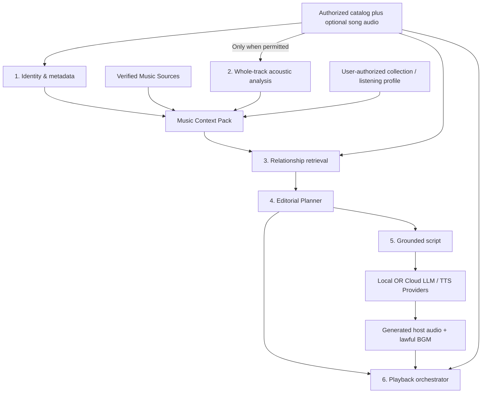

# Conceptual Architecture and Responsibility Boundaries

English | [简体中文](04-conceptual-architecture.zh-CN.md)

**Status:** proposed contracts, not implemented. This document alone owns system-layer definitions, model-provider selection, music-information processing and recommendation logic. No named demo track belongs here.

## A. Product/service separation

Start from **authorized platform/library metadata and behavioral data**, not a mandatory NAS or local music file. Playlist/catalog entry, recording identity, user listening statistics and licensed playable source are distinct. Music knowledge and local/cloud LLM/TTS are separately configurable.

| Responsibility | Proposal |
| --- | --- |
| Music metadata/behavior | Import authorized platform data, original play counts/added dates, preserve source |
| Catalog/player/AI DJ | **Music Assistant + AI Radio as first reuse candidate** |
| Personal music intelligence | Proposed Personal Music Report, verifiable music relation graph/Context Pack |
| Editorial producer | Proposed multiple show concepts, storytelling and feedback-driven segment edits |
| Lenovo Smart Storage | Optional integration later; no confirmed music API, no dependency |

## B. Music information model: identity, knowledge, sound



### B1. Metadata and reliable music knowledge

**From the file/catalog:** artist, track title, album/release, composer and contributor credits when present; date, duration, codec, version qualifiers and catalog IDs. Tag quality varies: a filename alone may not prove a specific recording.

**Resolved identity:** `Work` (composition), `Recording` (particular performance), `Release`, `Track`, `ArtistCredit`, `PlayableSource`. A file representing a movement of a larger work still counts as **one complete track** in v0.

**External enrichment:** known release/recording identifiers, verified collaborations, cover relationships, stylistic and historical facts with sources, confidence and retrieval dates. Possible sources include music metadata databases subject to licenses, attribution and query policies; never assume every inferred link is fact.

**Minimum gate:** confidently establish sufficient identity. Unknown/ambiguous identity returns a visible error or requests correction. Missing optional tags, cover art or acoustic analysis is not an automatic failure.

### B2. Acoustic characteristics (distinct from metadata)

For **lawfully analyzable local audio**, an optional analyzer may calculate whole-track descriptors: estimated tempo / pulse, rhythmic texture, chroma/key confidence, dynamics/energy curve, timbre/spectral summaries, instrument or genre hypotheses and audio embeddings. Outputs include model/version, uncertainty, analysis rights and time.

These are **computed features**, not historical facts. Descriptive labels such as “warm,” “melancholic,” or “similar guitar texture” are hypotheses; don't convert them into undocumented influence claims. First version does **not** require identifying or cutting within-song segments.

### B3. Personal Music Report and behavior fields

Store `source_platform, provider_track_id, imported_at, original_date_added, play_count, count_semantics, coverage_start/end, playlist_ids, favorites, matching_confidence, playable_sources` with unknown values marked. **Import date ≠ original added date; cumulative play count ≠ per-play history; counts from different sources are not automatically comparable.** Distinguish temporary listening spikes from durable collection centers.

A **Personal Music Report** is an inspectable, evidence-based output; a **Music Context Pack** is the relevant slice supplied to one episode, not an entire library. Neither requires original audio.

## C. From data to episode

Find familiar user music and credible artist/work/history connections. Offer several show directions (ongoing theme, recent interest, surprising links), or user-defined seed. Plan an adjustable ~15–20-minute narrative before TTS; prioritize musician relationships if requested, not mechanically alternate versions of a song. Metadata availability and playable rights must be checked separately. Render modular host/music items; a comment should selectively update affected segments and bridges. Remember unfinished routes without forcing sequential listening.

## D. Local and cloud model provider boundary

Use replaceable interfaces, not hardcoded model names:

- `TextLLMProvider`: `generatePlan(context, constraints)`, `writeScript(plan, sources)`; configuration may point to local inference or an explicitly selected cloud endpoint.
- `TTSProvider`: `synthesize(script, voice, pronunciationHints)` with local/cloud implementations and consistent audio output metadata.
- `AudioFeatureProvider`: local DSP or permitted local model analysis by default; cloud uploading of raw songs is **not** assumed or implicitly enabled.
- `KnowledgeProvider`: metadata/verified facts via permitted databases or cached content; network lookup is visibly a different privacy boundary from local-only analysis.

**Policy:** local/cloud choice is explicit and task-specific; document what data leaves the device, user authorization, costs and capabilities. If a requested local provider cannot run, report the error or ask permission to switch. **Never silently fail over to cloud.** Provider neutrality is an architectural promise, not proof of equivalent quality.

## E. Data and episode contracts

```json
{
  "recording": {
    "id": "recording:example",
    "work_id": "work:example",
    "release_id": "release:example",
    "credits": ["artist:example"],
    "source_ids": ["local:example"],
    "identity_confidence": "verified"
  },
  "candidate_relation": {
    "from_recording_id": "recording:seed",
    "to_recording_id": "recording:related",
    "relation_type": "shared_performer",
    "evidence_refs": ["source:catalog-entry"],
    "acoustic_observations": [],
    "playability": "local",
    "why_next": "A verified performer connects both recordings."
  },
  "episode": {
    "target_duration_sec": 900,
    "segments": [
      {"type": "host", "tts_asset_id": "host:intro", "bgm_asset_id": "bed:intro"},
      {"type": "music", "recording_id": "recording:seed", "source_policy": "resolve_at_playback"}
    ]
  }
}
```

Separate raw source metadata, computed features, evidence graph, selected editorial plan, host assets and playback projection. The library remains canonical for what the user has; AI-produced descriptions are revisioned, replaceable derivatives.

## F. Validation sequence

Authorized Apple Music Windows or equivalent export → audit original play count/date-added → Personal Music Report → compare generic vs personal episode planning → run **stock Music Assistant + AI Radio** → implement only measured gaps. No household-server scope.

## G. Music Assistant reuse assessment (source review 2026-11-18)

Sources: [server/dev](https://github.com/music-assistant/server/tree/dev/music_assistant), [frontend](https://github.com/music-assistant/frontend), [AI Radio](https://www.music-assistant.io/plugins/ai-radio/). Server/frontend Apache-2.0; third-party service terms, credentials and distribution need separate review. **Upstream ≠ integrated in our repo.**

| Code module | Existing responsibility | Test |
| --- | --- | --- |
| `controllers/music` | Library/database/favorites | API exposure of original added dates, play counts |
| `controllers/player_queues`, `controllers/streams` | Audio and queue | Licensed playback and reuse |
| `providers/apple_music`, `spotify`, `ytmusic`, `neteasecloudmusic`, `qqmusic` | Sources | Real account metadata, login stability and playback rights |
| `providers/ai_radio/provider.py`, `hosts.py`, `storage.py` | Show/Host state | Reuse hosting/show foundation |
| `providers/ai_radio/queue_dj.py`, `rendering.py`, `models.py` | DJ clips/segments | Partial editing/regeneration |
| `providers/smart_playlist`, `sonic_analysis`, `sonic_similarity` | Playlists/acoustic insight | Reuse rather than claiming novelty |
| `providers/openai_compatible`, `openai_tts` | LLM/TTS | Local/cloud with consent |
| `frontend/src` | Vue/TypeScript UI | API-based independent low-fi interface |

AI Radio is **Alpha** and already offers Hosts, Shows, segmented DJ narration and TTS. Unknown until real testing: personal statistics import, long-term reports, grounded multi-artist storytelling, candidate-program curation and listener feedback history.

[Apple Music integration](https://www.music-assistant.io/music-providers/apple-music/) audio playback is not officially supported by Apple; [NetEase](https://www.music-assistant.io/music-providers/netease-cloud-music/) needs an unofficial API service; [QQ Music](https://www.music-assistant.io/music-providers/qqmusic/) likewise needs rights review. Data access is not DRM capture/remix authorization.

