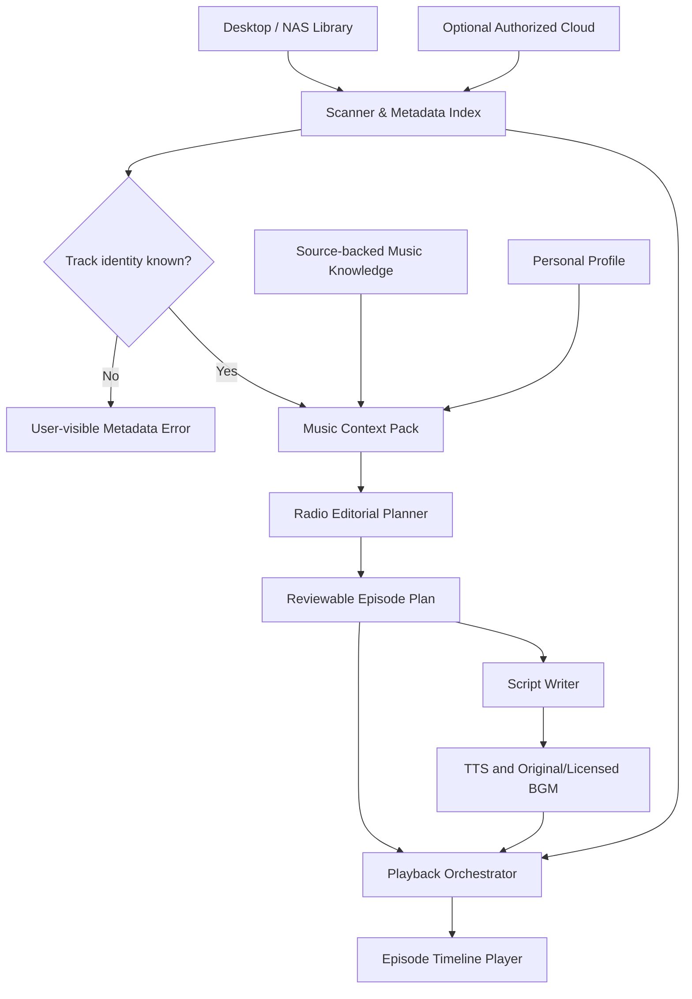

# Conceptual Architecture

**No implementation stack is committed.**



## Separation of responsibilities

**Music server:** file ownership, catalog indexing, lawful access and playback. Must work without the AI features.

**Music intelligence:** artist, work, recording, release, track, source; relationships supported by evidence; optional audio features and personal taste.

**Radio production:** select theme and songs *before* writing; maintain why-next explanation, citations and an editorially coherent program.

**Playback orchestration:** schedule narration and music as separate logical segments and handle source unavailability, timing and actual permissions.

## Conceptual data model

- Work: underlying composition where meaningful.
- Recording: a recorded performance/version.
- Release / Artist: album and credit metadata.
- Track: the user's library or catalog track record.
- PlayableSource / LocalFile: local copy or authorized platform reference.
- MusicRelation: evidence-backed musical, historical or stylistic connection.
- RadioEpisode: title, seed, theme, time budget, ordered segments.
- EpisodeSegment: host clip, BGM or authorized music queue item.

No automatic sub-track segmentation in v0; a movement can be one complete file.

## Example

```json
{
  "id": "episode-001",
  "title": "Beneath the Surface",
  "seed_track_id": "local-track-id",
  "target_duration_sec": 900,
  "editorial_thesis": "Repetition as motion",
  "segments": [
    {"type": "host", "script_id": "intro", "tts_asset_id": "tts-intro", "bgm_asset_id": "original-bed"},
    {"type": "music", "track_id": "local-track-id", "source_policy": "resolve_at_playback"}
  ]
}
```

## Safety, rights and quality constraints

Music identity precedes research. Keep source provenance and distinguish factual history from subjective listening notes. A streaming account does not grant an automatic right to capture, download, slice or mix DRM audio. Use separately generated TTS/BGM assets; music playback remains via authorized sources.

Local music playback can be subscription-independent; local LLM/TTS inference is optional for later evaluation. Unknown metadata, unavailable source or inadequate supporting evidence must generate a clear error or a revised plan rather than fabricated output.
