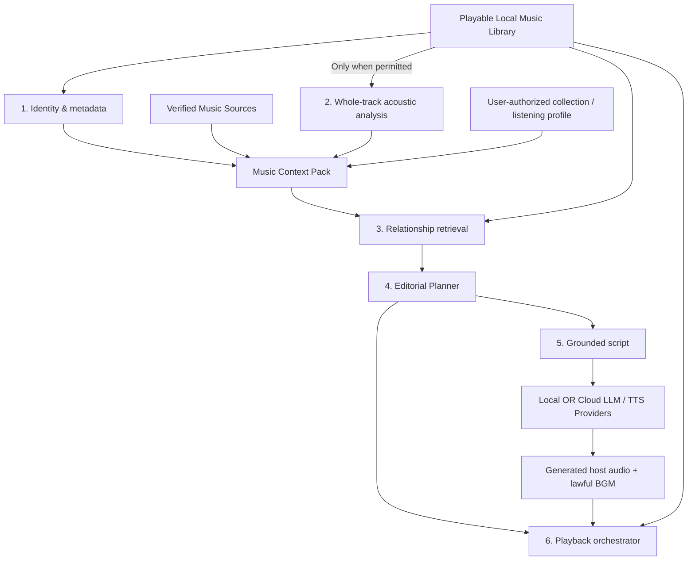

# Conceptual Architecture and Responsibility Boundaries

English | [简体中文](04-conceptual-architecture.zh-CN.md)

**Status:** proposed contracts, not implemented. This document alone owns system-layer definitions, model-provider selection, music-information processing and recommendation logic. No named demo track belongs here.

## A. Who provides the music server?

Distinguish **storage**, **music catalog access**, and **radio playback**. They are not the same component.

| Layer | Responsibility | Proposal |
| --- | --- | --- |
| Storage / home server | Persist audio, backup, folder rights and sharing | **User-controlled** PC folder, NAS or existing storage platform |
| Lenovo Smart Storage | Possible Lenovo-branded storage/backup/sharing substrate | **Candidate adapter, not a required dependency or confirmed SDK** |
| Existing music-server software | Optional index/stream API on top of stored files | Reuse if it meets rights/security requirements; not required for the first demo |
| AI Music Radio Library Adapter | Read authorized files/catalog entries; normalize identifiers, capabilities and URLs | **Our component**, starts with local folders |
| AI Music Radio Intelligence & Radio Engine | Understand metadata/audio, select music, write and voice radio episodes | **Our differentiated component** |
| Episode Player / Orchestrator | Schedule permitted music sources, speech and BGM | **Our component** |

Official Lenovo Smart Storage documentation establishes PC-backed private storage and music categorization, but does not itself establish a supported third-party metadata API, stream endpoint, or SDK. Evaluate authenticated read/list access, file handles, format support, server discovery, permissions and terms **before** promising an adapter. If unavailable, use a user-authorized local folder or independently supported media server.

References: [Lenovo Smart Storage overview](https://pcsupport.lenovo.com/us/en/solutions/HT518031) and [client app functions](https://pcsupport.lenovo.com/cm/en/solutions/ht518040-lenovo-smart-storage-client-app-features-on-pc).

## B. Music information model: identity, knowledge, sound



### B1. Metadata and reliable music knowledge

**From the file/catalog:** artist, track title, album/release, composer and contributor credits when present; date, duration, codec, version qualifiers and catalog IDs. Tag quality varies: a filename alone may not prove a specific recording.

**Resolved identity:** `Work` (composition), `Recording` (particular performance), `Release`, `Track`, `ArtistCredit`, `PlayableSource`. A file representing a movement of a larger work still counts as **one complete track** in v0.

**External enrichment:** known release/recording identifiers, verified collaborations, cover relationships, stylistic and historical facts with sources, confidence and retrieval dates. Possible sources include music metadata databases subject to licenses, attribution and query policies; never assume every inferred link is fact.

**Minimum gate:** confidently establish sufficient identity. Unknown/ambiguous identity returns a visible error or requests correction. Missing optional tags, cover art or acoustic analysis is not an automatic failure.

### B2. Acoustic characteristics (distinct from metadata)

For **lawfully analyzable local audio**, an optional analyzer may calculate whole-track descriptors: estimated tempo / pulse, rhythmic texture, chroma/key confidence, dynamics/energy curve, timbre/spectral summaries, instrument or genre hypotheses and audio embeddings. Outputs include model/version, uncertainty, analysis rights and time.

These are **computed features**, not historical facts. Descriptive labels such as “warm,” “melancholic,” or “similar guitar texture” are hypotheses; don't convert them into undocumented influence claims. First version does **not** require identifying or cutting within-song segments.

### B3. Personal context

With explicit permission: locally available playable recordings, favorites, playlist membership, recently/heavily played and collection timestamps. Collection-added date ≠ release date ≠ listening date. Missing listening history must not prevent catalog-driven recommendations.

## C. From a seed to a narrated music journey

1. **Candidate retrieval:** expand verified same-work recordings, covers, shared performers/collaborators, era/style links; supplement with acoustic similarity where permitted. Search **owned playable library first**. External items are separately flagged as discovery suggestions and cannot masquerade as locally playable.
2. **Evidence bundle:** each candidate carries `relation_type`, `evidence_refs`, `acoustic_observations`, `confidence`, `source_availability` and a short `why_next` hypothesis.
3. **Editorial selection:** reject unavailable or unsubstantiated candidates; balance relation strength, narrative contrast, diversity, personal familiarity and target duration. Avoid endless versions of the same composition unless it is the chosen editorial theme.
4. **Show plan:** choose theme and sequence **before** scriptwriting; create introduction, host bridges, complete recording slots and ending. Adapt runtime to actual full-track lengths.
5. **Grounded narration:** the LLM receives only relevant cited facts, identified listening observations and the selected sequence. It must not invent artistic intent or producer credits.
6. **Audio production + playback:** render original host speech and licensed/original BGM separately; schedule lawful recordings using their real playable source capabilities. Never assume protected stream PCM can be captured, trimmed or remixed.

**Crucial separation:** recommendation produces not merely `track_id + score`, but a *narratable relation* with evidence and availability. The narrative is an output of selection, not a license to fabricate links.

## D. Local and cloud model provider boundary

Use replaceable interfaces, not hardcoded model names:

- `TextLLMProvider`: `generatePlan(context, constraints)`, `writeScript(plan, sources)`; configuration may point to local inference or an explicitly selected cloud endpoint.
- `TTSProvider`: `synthesize(script, voice, pronunciationHints)` with local/cloud implementations and consistent audio output metadata.
- `AudioFeatureProvider`: local DSP or permitted local model analysis by default; cloud uploading of raw songs is **not** assumed or implicitly enabled.
- `KnowledgeProvider`: metadata/verified facts via permitted databases or cached content; network lookup is visibly a different privacy boundary from local-only analysis.

**Policy:** local/cloud choice is explicit and task-specific; document what data leaves the device, user authorization, costs and capabilities. If a requested local provider cannot run, report the error or ask permission to switch. **Never silently fail over to cloud.** Provider neutrality is an architectural promise, not proof of equivalent quality.

## E. Data and episode contracts

```json
{
  "recording": {
    "id": "recording:example",
    "work_id": "work:example",
    "release_id": "release:example",
    "credits": ["artist:example"],
    "source_ids": ["local:example"],
    "identity_confidence": "verified"
  },
  "candidate_relation": {
    "from_recording_id": "recording:seed",
    "to_recording_id": "recording:related",
    "relation_type": "shared_performer",
    "evidence_refs": ["source:catalog-entry"],
    "acoustic_observations": [],
    "playability": "local",
    "why_next": "A verified performer connects both recordings."
  },
  "episode": {
    "target_duration_sec": 900,
    "segments": [
      {"type": "host", "tts_asset_id": "host:intro", "bgm_asset_id": "bed:intro"},
      {"type": "music", "recording_id": "recording:seed", "source_policy": "resolve_at_playback"}
    ]
  }
}
```

Separate raw source metadata, computed features, evidence graph, selected editorial plan, host assets and playback projection. The library remains canonical for what the user has; AI-produced descriptions are revisioned, replaceable derivatives.

## F. MVP sequencing and unresolved integration

**First demo:** local directory → file tags and curated verified metadata → a small catalog of actual playable tracks → simple relation retrieval → plan/TTS/BGM → player. This is not a home-server product release.

**Next:** validate Smart Storage and music-server interfaces, background indexing, user profile, secure multi-device playback, local-model performance. No production server integration is claimed until validated.

Security and cost: path permissions, no public unauthenticated media endpoint, no secret/track uploads to Git, no silent external upload, explicit model/data permissions, rights-aware source resolution.
