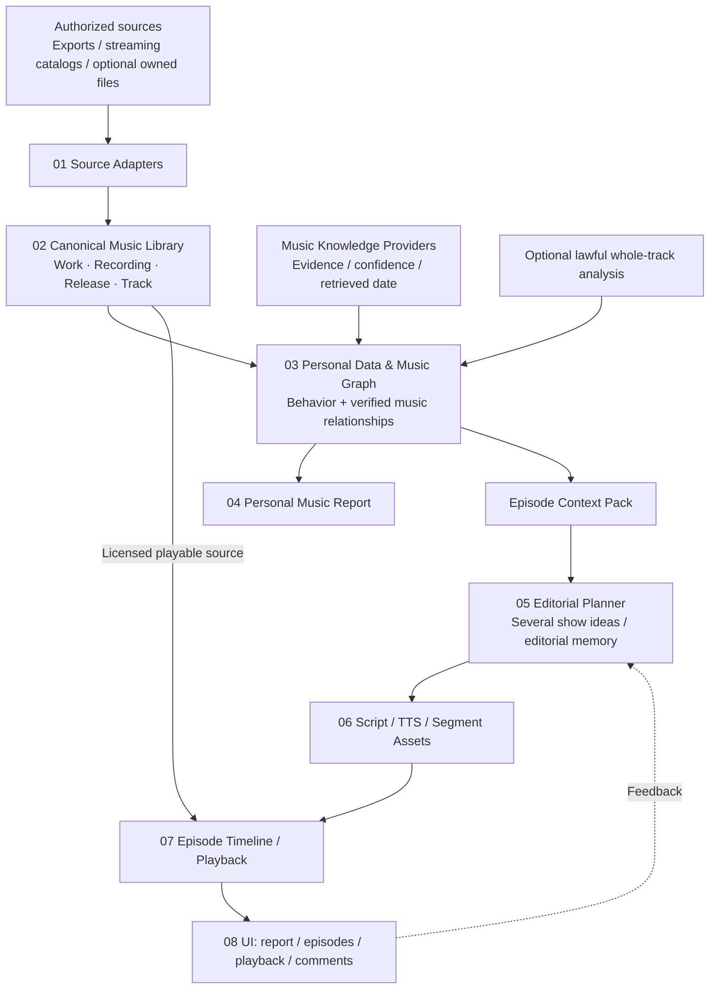

# System Architecture: Modules, Data Contracts and Music Assistant Reuse

English | [简体中文](04-conceptual-architecture.zh-CN.md)

This is the technical expansion of the [complete product README](../README.md): **what each module takes in, what it produces, what can be reused, and what should be built only after testing**. It is a proposed design and source-code review, not a claim that integration works.

## 1. End-to-end information flow



These are **logical components**, not necessarily separately running services. Music Assistant may supply the catalog, playback queue and existing AI DJ; other modules can connect over supported APIs. Runtime boundaries are decided after inspecting a working upstream installation.

## 2. Music Data Connectors

**Inputs:** authorized catalog, playlist and listening metadata from Apple Music, Spotify, YouTube Music, NetEase Cloud Music, QQ Music, optional owned audio files or an existing music library. An **Apple Music Windows export** is a prioritized initial test because play counts and date added are visible in the app; completeness of extraction still needs per-track validation.

Adapters must import and preserve provider identifiers, original statistics, source coverage, source capabilities, and candidate cross-platform matches. A file-based export can validate the experience before building continuous account sync.

**Field discipline:** `original_date_added` must not be replaced by `imported_at`; cumulative `play_count` is not an individual play-event history; provider counts may have incompatible time and measurement definitions. Derived event counts retain a documented threshold and coverage.

```json
{
  "source_platform": "provider-example",
  "provider_track_id": "track-001",
  "title": "Example Track",
  "artist_ids": ["artist-001"],
  "album_id": "album-001",
  "play_count": 42,
  "count_semantics": "provider_cumulative",
  "original_date_added": "2024-03-18",
  "imported_at": "2026-11-18",
  "coverage": {"start": null, "end": null, "known": false},
  "playlist_ids": ["playlist-007"],
  "favorite": true,
  "metadata_capability": "read",
  "playback_capability": "unknown"
}
```

This illustrates a **proposed normalized record**, not a promise that every platform exposes these values.

## 3. Canonical Music Library

Preserve distinctions between **Work** (composition), **Recording** (particular performance/recorded rendition), **Release**, **Track** (source catalog entry), **ArtistCredit**, and **PlayableSource**. One work can have multiple recordings and release tracks; a same-title match is not proof of identical audio.

Several platform entries may map to one Recording, but original IDs, favorites, playlist membership, play counts and individual playback rights remain source-specific. Canonical identity should not erase personal history.

**Reuse candidate:** Music Assistant `controllers/music`, provider connectors and query APIs. Inspect real catalog identity behavior and whether original user-statistics fields are exposed; store unexposed personal signals in our data adapter instead of assuming invasive changes to the playback database.

## 4. Personal Music Intelligence

Two related evidence classes are kept distinct:

- **User facts and behaviors:** favorites, playlists, original dates added, total plays, explicitly supplied feedback. Patterns may reveal persistent centers, periods of interest or recent replay spikes. Play frequency alone does not establish personal emotional significance.
- **Musical facts and relationships:** documented performer credits, collaborations, covers, writing credits, releases, eras and stylistic history. Each edge keeps relation type, evidence references, confidence and retrieval time; LLM hypotheses are clearly labeled as hypotheses.

Optional lawful whole-track acoustic analysis can add estimates for tempo, rhythm, timbre, dynamics, chroma/harmony and embeddings with model version and confidence. Acoustic similarity does **not** demonstrate historical artistic influence. A valuable graph and report can still be made from metadata-only imports.

The personal graph should help answer “why is this story relevant to **this** listener?” Graph centrality is a lead to investigate, not an automatic measure of cultural or emotional importance.

## 5. Personal Music Report vs Music Context Pack

A **Personal Music Report** is a user-facing inspectable artifact: collection evolution, artist/recording relations, long-term versus short-term interests, and promising routes into music history, with supporting observations and sources.

A **Music Context Pack** is an **episode-specific** set of pertinent tracks, personal signals, verified history and playback state. It is not a dump of the entire library into an LLM prompt. Both derive from the personal graph; they serve different jobs.

## 6. Editorial Planner

Planning precedes text-to-speech. Given user familiarity, verified relationships, episode theme, available recordings and real durations, the planner offers a small set of distinct show ideas: continuation, recent interest, unexpected relationship or a user-specified topic.

A proposed plan includes `theme`, `editorial_intent`, `target_duration`, `chapters[]`, `track_slots[]`, `narration_slots[]`, `evidence_refs[]` and `playback_constraints`. Starting from one song need not mean comparing multiple recordings of that song; if the listener wants the performers' stories, that intent governs the editorial arc.

**Editorial Memory** tracks previously told stories, open questions, listener comments and repetition. The aim is a compelling next episode, not an obligatory never-ending serial.

## 7. Modular Radio Production and Playback

An episode contains distinct **Host Intro, Narration, Bridge, Music Item, Outro** units. Produce scripts and TTS clips per unit, then schedule actual song durations and licensed/original BGM separately. Subscription playback permissions must not be confused with rights to extract protected audio for rendering or remixing.

Feedback routes first to editorial planning. Identify affected sections and track slots, revise the necessary scripts, keep unaffected audio assets when practical and rerender adjacent bridges when continuity requires. Some large thematic changes necessarily affect more of the show; modularity is not a zero-cost guarantee.

Suggested replaceable interfaces are `TextLLMProvider`, `TTSProvider`, `KnowledgeProvider`, optional `AudioFeatureProvider`. Text research, narration, catalog metadata and actual audio playback may come from different approved services. Remote processing must reflect the listener's consented data scope.

## Music Assistant reuse assessment

[Official website](https://www.music-assistant.io/) · [AI Radio](https://www.music-assistant.io/plugins/ai-radio/) · [Server](https://github.com/music-assistant/server) · [Frontend](https://github.com/music-assistant/frontend).

The server and frontend expose open-source code. Third-party provider credentials, terms and redistribution rights need separate assessment. The following table is a **source/documentation-backed reuse proposal**, not a verified integration.

| Upstream module | Existing responsibility | Proposed reuse | Specific gap to test |
| --- | --- | --- | --- |
| `controllers/music` | Catalog, library, favorites, search | Reuse its library APIs | Original play counts and date-added access |
| `providers/apple_music`, `spotify`, `ytmusic`, `neteasecloudmusic`, `qqmusic` | Music source connectors | Combine with our own metadata imports | Real user data, login stability, legal playback |
| `controllers/player_queues`, `controllers/streams` | Queues and streams | Reuse playback | Hosted speech interleave, rights, recovery, latency |
| `providers/ai_radio/provider.py`, `hosts.py`, `storage.py` | Host/show configuration and persistence | Reuse show foundation | External editorial-plan integration |
| `providers/ai_radio/queue_dj.py`, `rendering.py`, `models.py` | DJ queue and segmented generation | Reuse audio clips | Selective revision and asset reuse |
| `providers/smart_playlist` | Smart playlists | Candidate selection support | Personal-graph evidence input |
| `providers/sonic_analysis`, `sonic_similarity` | Acoustic and similarity features | Optional enrichment | Audio rights and actual value |
| `providers/openai_compatible`, `openai_tts` | Text and TTS models | Provider reuse/adapters | Local/cloud quality and privacy |
| `frontend/src` and API | Existing Web/PWA | Low-fi API-based experience first | Report, episode choices, commenting |

**Clear overlap:** unified catalog, player, basic AI DJ, hosts, TTS, segments, playlist and sonic features. **Unverified incremental value:** original user-statistics-based long-term report, researched multi-artist storytelling, several editorial options, episode feedback and selective rerendering. We must test the stock plugin rather than presupposing these are missing.

Provider rights remain a separate risk: Music Assistant's Apple Music playback route is not officially supported by Apple; some other sources rely on unofficial APIs. Catalog readability, commercial track playback and audio mixing rights must be independently checked.

## 9. Validation and engineering decisions

1. **Data PoC:** audit a consented music export, especially original plays and dates.
2. **Intelligence PoC:** generate the report and evaluate generic versus personal-context episode plans.
3. **Music Assistant PoC:** run the unmodified server and AI Radio, inspect actual API fields and recordings; mark reuse/adapt/build.
4. **Experience PoC:** connect the report, show choices, comments and playback using monochrome low-fi UI. Choose a plugin, external service or other integration style only after API tests.

Actual implementation status belongs to [STATUS](STATUS.md); acceptance belongs to [MVP](02-mvp-and-requirements.md). All above interfaces are proposed.
