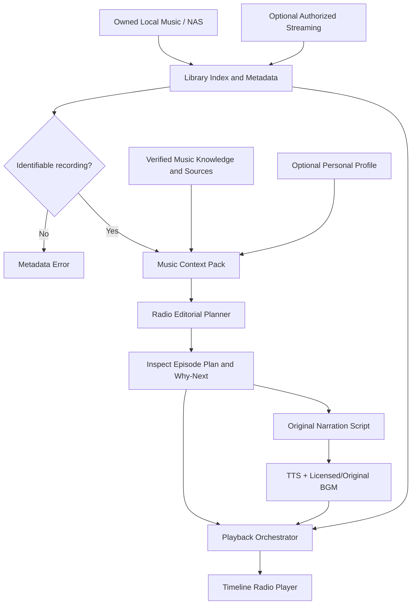

# Conceptual Architecture

English | [简体中文](04-conceptual-architecture.zh-CN.md)

**Design draft, not an implemented stack.**



## Canonical music concepts

- **Work:** the underlying composition, e.g., Bob Dylan's *My Back Pages* (1964).
- **Recording:** a specific performance, e.g., Dylan solo (1964), The Byrds' recording (1967), or the six-artist 1992 Madison Square Garden live recording.
- **Release:** album/publication that contains the recording; recording year and release year need not match.
- **Artist / Credit:** credited writer, performer, featured contributor, band and distinct roles.
- **Track:** the library/catalog item's visible representation.
- **PlayableSource:** local file or authorized streaming reference and its available playback capabilities.
- **MusicRelation:** evidence-backed relation such as **same work / cover / collaboration / stylistic influence**. Do not infer causal influence without evidence.
- **RadioEpisode / EpisodeSegment:** editorial plan and separate narration/music timeline items.

A track/file can be a self-contained section of a larger work; **v0 has no internal segment recognition requirement**.

## Why the Dylan seed matters to architecture

One selected **1992 live Recording** links to one underlying **1964 Work**, an original 1964 recording, a 1967 The Byrds recording, and six distinguished participating performers. This tests **recording identity, multi-artist credit, event context and evidence-grounded branching** more meaningfully than a simple nearest-neighbor playlist.

Sources for metadata claims:
- [Bob Dylan official concert description](https://www.bobdylan.com/albums/30th-anniversary-concert-celebration-deluxe-edition/)
- [Legacy Recordings track list](https://www.legacyrecordings.com/releases/30th-anniversary-concert-celebration-deluxe-edition-2-cd/)
- [MusicBrainz event/recording credits](https://musicbrainz.org/release/94fb18c0-610e-41e2-853f-32a442427a90)

## Example structured episode

```json
{
  "id": "demo-six-voices",
  "seed_recording_id": "local-1992-live-my-back-pages",
  "work_id": "my-back-pages-composition",
  "title": "Six Voices, One Song",
  "target_duration_sec": 900,
  "editorial_thesis": "How one song changes across voices and decades",
  "segments": [
    {
      "type": "host",
      "script_id": "intro",
      "tts_asset_id": "host-intro",
      "bgm_asset_id": "licensed-bed-01"
    },
    {
      "type": "music",
      "recording_id": "local-1992-live-my-back-pages",
      "source_policy": "resolve_at_playback"
    }
  ]
}
```

## Service responsibilities and contracts

**Personal music server:** persistent lawful file storage, library metadata, permissions and playback. Useful independently of AI.

**Music research:** identifies composition vs recording vs publication, retains attribution and evidence, and distinguishes verified facts from listening impressions.

**Editorial producer:** plans theme and sequence before script generation, includes every recommendation's why-next evidence and a source availability check.

**TTS/BGM:** generates **original host assets**; never assumes protected streaming PCM is accessible for slicing or remixing.

**Playback orchestrator:** schedules separate host and permitted music assets, handles real durations, source failure and user control.

**Privacy:** never silently upload private audio, library or listening history to external AI; explicit provider configuration and scopes only.

The product may use local or cloud models depending on consent, resource and quality; avoid hardcoded vendor or hardware commitments.
