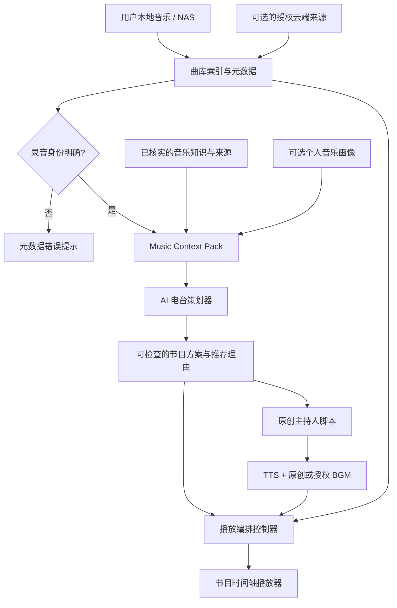

# 概念架构

[English](04-conceptual-architecture.md) | 简体中文

**目前仅为设计草案，不代表已经实现或选定技术栈。**



## 核心音乐实体

- **Work｜作品：** 抽象的音乐创作，例如 Bob Dylan 创作于 1964 年的《My Back Pages》。
- **Recording｜录音：** 具体录制的演唱版本，例如 Dylan 1964 年独唱、The Byrds 1967 年版本，以及 1992 年六人现场合唱。
- **Release｜发行：** 承载录音的专辑及发行信息；演出/录音年份与专辑发行年份不一定相同。
- **Artist / Credit｜音乐人与署名：** 作曲者、演奏者、客座嘉宾、乐队及各自身份。
- **Track｜曲目：** 曲库或音乐平台中用户看到的歌曲条目。
- **PlayableSource｜可播放来源：** 本地文件或具有实际播放权限的云端引用，以及来源允许的操作。
- **MusicRelation｜音乐关系：** 有证据的同一作品、翻唱、合作、风格联系等。不能仅因听感相似就认定存在创作影响关系。
- **RadioEpisode / EpisodeSegment｜节目及片段：** 节目方案与相互独立的主持语音、BGM、音乐播放项。

完整文件即使属于大型作品中的一个章节，v0 也不做文件内部的自动乐段识别。

## 为什么 Dylan 演示能够验证架构

**一份 1992 年现场 Recording** 可以关联同一个 **1964 年 Work**、1964 年的原版 Recording、The Byrds 1967 年的另一份 Recording，以及六位参与演唱的音乐人。这个案例检验的正是**录音身份、多位音乐人署名、演出事件以及有出处的多路径延展**，比纯粹的“找几首相似歌曲”更能体现音乐知识系统的价值。

事实核查资料：
- [Bob Dylan 官方纪念演唱会说明](https://www.bobdylan.com/albums/30th-anniversary-concert-celebration-deluxe-edition/)
- [Legacy Recordings 演出曲目列表](https://www.legacyrecordings.com/releases/30th-anniversary-concert-celebration-deluxe-edition-2-cd/)
- [MusicBrainz 现场录音和演出者信息](https://musicbrainz.org/release/94fb18c0-610e-41e2-853f-32a442427a90)

## 节目数据示例

```json
{
  "id": "demo-six-voices",
  "seed_recording_id": "local-1992-live-my-back-pages",
  "work_id": "my-back-pages-composition",
  "title": "Six Voices, One Song",
  "target_duration_sec": 900,
  "editorial_thesis": "How one song changes across voices and decades",
  "segments": [
    {
      "type": "host",
      "script_id": "intro",
      "tts_asset_id": "host-intro",
      "bgm_asset_id": "licensed-bed-01"
    },
    {
      "type": "music",
      "recording_id": "local-1992-live-my-back-pages",
      "source_policy": "resolve_at_playback"
    }
  ]
}
```

## 服务职责与边界

**私人音乐服务器：** 保管合法本地文件、维护曲库索引、访问权限及播放能力。即使 AI 被关闭也必须有独立价值。

**音乐研究层：** 区分作品、录音、发行，保存来源及音乐人署名；明确区分事实与主观听觉观察。

**节目策划层：** 先选主题和歌曲，再写主持稿；每次推荐必须有证据和可播放性检查。

**TTS/BGM：** 只生成原创主持音轨和授权背景音轨，不假定可以取得受保护流媒体的 PCM 并裁切、再混音。

**播放控制器：** 分别调度口播和合法音乐，支持真实时长、来源失效和用户控制。

**隐私：** 不可静默向外部 AI 上传个人曲库文件、私人收听历史或其他个人数据；应由用户/管理员明确配置服务与授权范围。

模型可以依据用户同意、硬件资源和体验需求选择本地或云端，不应过早绑定特定厂商或硬件。
