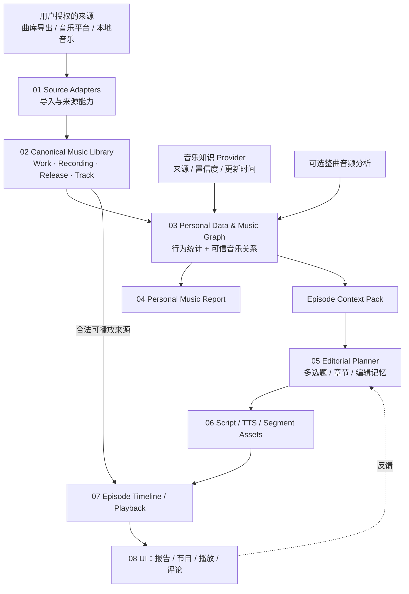

# 系统架构：模块、数据合同与 Music Assistant 复用

[English](04-conceptual-architecture.md) | 简体中文

本文是 [README 完整产品说明](../README.zh-CN.md)的技术展开。它回答：**系统每一层输入什么、产出什么；有哪些现成组件；哪些能力才需要我们实现；怎样在实际验证前避免重复建设。** 目前是设计与代码研究，不代表完成了服务集成。

## 1. 端到端数据流



这是**逻辑模块**而不是要求每个方框都变成独立进程。Music Assistant 可以承担曲库、队列与已有 AI DJ；其他部分可通过接口或插件接入。具体工程拆分要在运行原版之后确定。

## 2. Music Data Connectors：先拿到真实个人数据

**输入：** Apple Music / Spotify / YouTube Music / 网易云 / QQ 音乐等在许可范围内提供的目录、歌单与统计；用户可选的本地歌曲和现有音乐服务器。**第一优先**是 Apple Music Windows 曲库元数据验证，因为它在客户端界面上能展示播放次数和添加日期，但导出完整性必须逐曲核对。

适配器最少应承担：导入、身份映射、原始统计字段保存、来源标记、能力检测（仅可查询/可实际播放）、去重候选。可以先从文件导入，之后再看平台 API 和增量同步；不要让登录某个平台成为唯一的方式。

**字段纪律：** `original_date_added` 不得用 `imported_at` 代替；累计 `play_count` 不等于完整播放事件；不同平台计数口径不可直接相加。能从合法历史事件计算次数时保留计算方式和覆盖期间。

```json
{
  "source_platform": "provider-example",
  "provider_track_id": "track-001",
  "title": "Example Track",
  "artist_ids": ["artist-001"],
  "album_id": "album-001",
  "play_count": 42,
  "count_semantics": "provider_cumulative",
  "original_date_added": "2024-03-18",
  "imported_at": "2026-11-18",
  "coverage": {"start": null, "end": null, "known": false},
  "playlist_ids": ["playlist-007"],
  "favorite": true,
  "metadata_capability": "read",
  "playback_capability": "unknown"
}
```

这是拟议数据合同的示例，不代表 Apple Music 或其他 Provider 一定提供所有这些字段。

## 3. Canonical Music Library：身份与可播放性分离

统一实体保持 **Work（作品）— Recording（某次具体录音/演奏）— Release（专辑/发行）— Track（某来源中的条目）— ArtistCredit（署名）— PlayableSource（实际播放入口）** 的区分。

例如同名歌曲可能来自不同录音、演唱会现场或发行版。多个平台条目可匹配到同一 Recording，但**原始平台 ID、用户收藏、原始播放次数和可播资格仍要独立保存**，不能因合并身份而丢失平台属性。

**复用候选：** Music Assistant `controllers/music`、音乐 `providers/*`、音乐数据库和目录查询 API。需要实际检查它如何表达不同来源的同一歌曲，以及能否返回原始用户统计。它不暴露的字段可由我们的 Data Adapter / Personal Data Store 维护，不必入侵整个播放器数据库。

## 4. Personal Music Intelligence：个人音乐图谱与可信关系

这层拥有两个性质不同的数据子集：

- **个人事实与行为**：用户的收藏、歌单关系、原始添加日期、累计播放次数、用户明确讲过的偏好和评论；分析长期中心、阶段性变化、近期重复等趋势，但不得把播放量直接等价为人生意义。
- **音乐知识与关系**：音乐人参与演奏、合作、创作署名、作品翻唱、发行、年代、风格沿革；每条关联保留 relation type、资料来源、可信度与更新时间。模型推断的联系要单独标明，不能冒充史实。

可选声学特征层读取**允许被分析的音频**，增加速度、节奏、音色、能量、和声、Embedding 等估计，并标明算法及置信度；这些不是作品归属和创作影响的证据。**不依赖音频也能形成有意义的音乐知识关系。**

Personal Music Graph 应帮助找到“为什么用户可能对这个故事感兴趣”，而不是每次仅输出相关性分数。类似图谱中节点的连接中心性是值得调查的线索，但不构成自动的价值判断。

## 5. Personal Music Report 与 Music Context Pack

**Personal Music Report** 是用户能打开的产品成果：收藏/听歌变化、常见音乐人及关系、长期与近期热点的区别、值得探索的音乐史路线，以及这些判断来自哪些字段。以数据支持的解释取代仅供情绪体验的玄学标签。

**Music Context Pack** 是供单次节目使用的内部资料包：只检索与本期主题相关的歌曲、用户行为、可信史实与可播放状态，而不把全部曲库发送给 LLM。

二者共享底层音乐图谱，但**Report 是解释给人看的结果，Context Pack 是给模型使用的精简上下文**；不要混成单一的 Prompt Dump。

## 6. Editorial Planner：AI 是编辑，而非歌单排序器

策展在 TTS 前完成。编辑器需要根据主题、用户熟悉程度、音乐事实证据、真实时长与可播放性，至少给出几个有区别的节目方向；可来自未讲完的线索、近期收藏、图谱中的意外连接或用户明确要求。

单期节目建议包含 `theme`、`editorial_intent`、`target_duration`、`chapters[]`、`track_slots[]`、`narration_slots[]`、`evidence_refs[]`、`playback_constraints`。**从一首歌出发不意味着总要比较它的不同录音版本；用户希望听音乐人关系时，应优先利用相关音乐人及其其他作品。**

Editor Memory 是策展状态，不等同于无限生成一串节目：记录已讲主题、尚未展开的关系、用户评论，以及哪些选题已经重复。它要帮助生成“值得听的下一期”，而不是逼用户补完所有旧故事。

## 7. Radio Production：模块化资产和播放时间轴

节目包含可单独管理的 **Host Intro、Narration、Bridge、Music Item、Outro**。先按章节写稿，按段落 TTS，再使用真实歌曲时长和有版权许可的 BGM 组合。音乐播放项与 TTS/原创 BGM 分别管理，不能默认取得受保护音乐的 PCM、切片或混音许可。

修改发生时，从用户反馈先回到 Planner：识别受影响的章节、曲目与衔接，重写必要脚本，优先复用不受影响的已有语音资产；更新相邻串场和时间轴。不同主题修改可能会触发较大规模重做，**模块化不保证所有修改都零成本**。

模型接口建议保持可替换：`TextLLMProvider`、`TTSProvider`、`KnowledgeProvider` 与可选 `AudioFeatureProvider`。文本策划、TTS、歌曲目录、真正播放可以使用不同 Provider。用户明确决定是否使用云端和传输什么私人内容。

## 8. Music Assistant 复用评估

[Music Assistant 官方文档](https://www.music-assistant.io/) · [AI Radio 插件](https://www.music-assistant.io/plugins/ai-radio/) · [Server](https://github.com/music-assistant/server) · [Frontend](https://github.com/music-assistant/frontend)。

其服务端和前端是可查看源码的开源项目；具体第三方 Provider 另有凭据、授权和使用条款。下表是**源码/文档层面确认的模块与拟议集成点**，还没有完成我们的端到端测试：

| Music Assistant 模块 | 现有能力 | 复用方式 | 必须核查的缺口 |
| --- | --- | --- | --- |
| `controllers/music` | 曲库、目录、收藏、搜索 | 以其目录/查询作为基础 | 原始 Play Count 与 Date Added 是否可通过 API 取得 |
| `providers/apple_music`、`spotify`、`ytmusic`、`neteasecloudmusic`、`qqmusic` | 音乐源连接 | 与自有导入 Adapter 配合 | 登录稳定性、统计完整性、平台条款和播放权益 |
| `controllers/player_queues`、`controllers/streams` | 歌曲队列与流 | 借用播放器与时间轴 | 与主持音频交替、权限、失败恢复和延迟 |
| `providers/ai_radio/provider.py`、`hosts.py`、`storage.py` | AI Radio 入口、主持人、节目状态 | 复用基础节目/主持人模型 | 可否接受我们外部策划结果 |
| `providers/ai_radio/queue_dj.py`、`rendering.py`、`models.py` | 插入 DJ 口播和分段渲染 | 优先复用 Segment 制作 | 修改一部分内容能否避免整期重生成 |
| `providers/smart_playlist` | 条件歌单与发现 | 辅助候选选曲 | 能否结合我们提供的个人关系证据 |
| `providers/sonic_analysis`、`sonic_similarity` | 整曲声学与相似性能力 | 可选丰富化 | 数据取得权限、质量与成本 |
| `providers/openai_compatible`、`openai_tts` | 文本与语音 Provider | 复用/适配 | 本地/云端切换、隐私、音色与实际质量 |
| `frontend/src` 与 Music Assistant API | 已有 Web/PWA 操作界面 | 先连接 API 做概念前端 | 个人报告、节目选题与评论是否需要独立 UI |

**已经明确的重合：** 多源曲库、基础播放器、DJ 口播、节目主持人、TTS、声学/歌单增强。**尚未证明的差异：** 从真实个人收藏形成长期音乐报告；具有较深音乐史研究的多期策展；多候选节目选择；评论驱动的局部编辑。我们应在原版 AI Radio 上测试，而不是先宣称没有或重新编写。

**授权风险：** Music Assistant 的 Apple Music 播放方式不等同于 Apple 官方支持的商业集成；网易云等非官方接入也存在变动风险。拿到目录、能播放商业歌曲、能对其音轨加工是不同的权限；不能因为 Provider 已有代码就直接承诺完整体验。

## 9. 迭代策略：先验证价值和复用，再决定工程形态

1. **Data PoC：** 真实授权曲库导出与数据覆盖审计，特别核查次数与添加日期。
2. **Intelligence PoC：** Personal Music Report + 有来源的关系；同主题通用 vs 个人 Context 的策展对照。
3. **Music Assistant PoC：** 运行原版系统和 AI Radio，读取 API 及真实节目结果，标注可直接复用、需要适配、需要自研。
4. **Experience PoC：** 用黑白低保真界面连接报告、节目选择、评论和播放。最终是否 Fork、插件开发或外部服务组合，应基于接口与测试选择。

**实现状态及验收以**[STATUS](STATUS.zh-CN.md)和[MVP](02-mvp-and-requirements.zh-CN.md)为准；本架构里的模块和接口尚属建议。
