# 概念架构与责任边界

[English](04-conceptual-architecture.md) | 简体中文

**状态：** 本文描述拟议接口和系统责任，尚无对应实现。**只有本文**维护服务器分工、模型选择、音乐信息分层与推荐逻辑。具体 Demo 歌曲不应出现在这里。

## A. 音乐服务器由谁提供？

必须区分**文件存储**、**音乐目录服务**和**节目播放**，这不是同一个东西。

| 层级 | 负责的事情 | 当前建议 |
| --- | --- | --- |
| 存储/家庭服务器 | 音频持久保存、备份、目录权限、文件共享 | **用户已有的** PC 目录、NAS 或存储软件 |
| Lenovo Smart Storage | 可复用的联想存储、备份、共享基础平台 | **优先评估的候选适配器，不是已确认的 SDK 或必需依赖** |
| 现成音乐服务器 | 选择性提供建库、音乐目录检索和播放流接口 | 满足权限/安全时优先复用；首个 Demo 不要求引入 |
| AI Music Radio Library Adapter | 访问已授权文件/目录，统一录音身份与可播放能力 | **本项目开发**，首先支持本地目录 |
| AI Music Radio Intelligence / Radio Engine | 理解元数据与声音，关联选歌、节目策划与主持 | **本项目核心差异化能力** |
| Episode Player / Orchestrator | 分别调度合法歌曲、主持语音与 BGM | **本项目开发** |

联想官方 Smart Storage 资料能证明其提供 PC 本地私有存储及音乐分类，但**不能据此认定已有第三方可调用的元数据 API、音频流接口或 SDK**。要先验证认证方式、文件列举/读取、格式、服务发现、权限及许可，再承诺适配。未满足时退回用户授权的本地目录或有正式接口的音乐服务器。

参考：[Lenovo Smart Storage 官方说明](https://pcsupport.lenovo.com/us/en/solutions/HT518031)、[PC 客户端功能说明](https://pcsupport.lenovo.com/cm/en/solutions/ht518040-lenovo-smart-storage-client-app-features-on-pc)。

## B. 音乐信息：身份、知识和声音

```mermaid
flowchart TD
  S[可播放的私人曲库] --> ID[1. 身份与元数据]
  ID --> CTX[Music Context Pack]
  K[有证据的音乐知识来源] --> CTX
  S -->|有分析权限才读取音频| AF[2. 整曲声学分析]
  AF --> CTX
  P[用户授权的收藏/收听画像] --> CTX
  CTX --> RET[3. 音乐关系召回]
  S --> RET
  RET --> PLAN[4. 节目策划器]
  PLAN --> SCRIPT[5. 可信主持稿]
  SCRIPT --> PROVIDER[本地或云端 LLM / TTS Provider]
  PROVIDER --> ASSET[主持语音与合法 BGM]
  PLAN --> PLAY[6. 播放编排]
  ASSET --> PLAY
  S --> PLAY
```



### B1. 元数据与可靠音乐知识

**直接从文件/目录读到的：** 音乐人、曲名、专辑/发行、作曲者与参与者（如存在）、年份、时长、编解码、版本标记和目录 ID。标签质量可能较差，单靠文件名无法确保“具体录音”的身份正确。

**统一音乐身份：** `Work`（作品）、`Recording`（具体演唱/演奏）、`Release`（发行）、`Track`（曲库条目）、`ArtistCredit`（音乐人署名）、`PlayableSource`（实际来源）。大型作品中的某个独立章节文件在 v0 仍然是一首完整录音，不做文件内切段。

**联网知识补全：** 在许可范围内读取作品/录音身份、经证实的合作、翻唱关系和有出处的风格/历史背景，并保留来源、可信度、检索日期；**模型的联想不等于历史事实**。

**最低门槛：** 必须能以足够把握识别录音。无法识别或存在严重歧义时提示用户修正或明确报错；缺少封面、年份、部分标签或声学分析不是自动失败条件。

### B2. 声学特征：与元数据严格区分

对于**可合法分析的本地歌曲**，可选的 Analyzer 提取整曲速度/节拍、节奏形态、Chroma/调性置信度、动态和能量变化、音色/频谱摘要、乐器/风格假设及音频 Embedding。每项特征保留算法/模型版本、置信度、分析授权和时间。

这些属于**算法提取的特征**，不是音乐历史事实。“温暖”“忧郁”“吉他质感接近”只能作为听感假设，不允许推导出未经证实的创作影响关系。首版**不做歌曲内部结构定位与自动切片**。

### B3. 个人音乐上下文

在用户允许时利用本地真实可播放曲目、收藏、歌单、历史播放及歌曲入库日期。**发行日期 ≠ 收藏日期 ≠ 播放日期**。没有完整收听历史时，仍应能基于目录与音乐知识推荐。

## C. 如何从一首歌延伸成节目？

1. **候选召回：** 通过同一作品的不同录音、翻唱、共同演奏者、合作、年代/风格等有证据的关系，再以合法计算的声学相似性补充。**优先搜用户自己的曲库**。外部未拥有音乐只能标记为探索建议，不得伪装为本地可播放。
2. **关联证据包：** 每个候选包含 `relation_type`、`evidence_refs`、`acoustic_observations`、`confidence`、`source_availability` 及简短的 `why_next`。
3. **节目选曲：** 剔除不可播放或没有足够依据的候选，在关系强度、叙事对比、曲目多样性、用户熟悉程度、目标时长间做平衡。除非明确是“版本比较”主题，否则不能连续塞满同一作品的不同版本。
4. **先策划再写稿：** 选出节目主题和歌曲顺序，定义开场、串场、完整歌曲和收尾，并根据真实歌曲时长调整。
5. **主持词生成：** LLM 仅接收与选曲有关的可靠音乐事实、注明主观性的声学观察与当前节目方案，避免凭空编造作者意图或制作署名。
6. **制作并播放：** 生成原创主持语音、原创/授权 BGM，通过各自合法的来源独立播放歌曲；不可假定 DRM 音频能够抽取、裁切和再混音。

**关键：** 推荐结果不能只有 `track_id + score`，还要有可用于叙事的**音乐关系、证据与可播放状态**。讲述是对推荐的解释，而不是制造不存在的联系。

## D. 本地/云端模型怎样支持？

以可替换能力接口替代写死某个模型：

- `TextLLMProvider`：`generatePlan(context, constraints)` / `writeScript(plan, sources)`，可配置本地推理端点或用户明确选择的云端服务。
- `TTSProvider`：`synthesize(script, voice, pronunciationHints)`，本地及云端实现输出统一语音资产和时长等元数据。
- `AudioFeatureProvider`：默认在本地以 DSP 或获得允许的本地模型分析；**不假设可以把商业歌曲原音上传云端**。
- `KnowledgeProvider`：从允许使用的音乐数据库或本地缓存获取真实资料；联网查询是与纯本地处理不同的数据/隐私边界。

**规则：** 本地/云端可按能力分别选择，明确显示数据是否出设备、用途、费用与许可。若选定本地模型无法运行，要报错或征得切换同意，**不得静默回退到云端**。Provider 抽象不等于已经证明不同模型效果相当。

## E. 基本数据合同

```json
{
  "recording": {
    "id": "recording:example",
    "work_id": "work:example",
    "release_id": "release:example",
    "credits": ["artist:example"],
    "source_ids": ["local:example"],
    "identity_confidence": "verified"
  },
  "candidate_relation": {
    "from_recording_id": "recording:seed",
    "to_recording_id": "recording:related",
    "relation_type": "shared_performer",
    "evidence_refs": ["source:catalog-entry"],
    "acoustic_observations": [],
    "playability": "local",
    "why_next": "通过可证实的共同演奏者关联两份录音"
  },
  "episode": {
    "target_duration_sec": 900,
    "segments": [
      {"type": "host", "tts_asset_id": "host:intro", "bgm_asset_id": "bed:intro"},
      {"type": "music", "recording_id": "recording:seed", "source_policy": "resolve_at_playback"}
    ]
  }
}
```

分开维护源文件与原始标签、计算得到的声学特征、可信的音乐关系、选择后的节目方案、语音资产和播放视图。用户的曲库事实不应被 AI 生成内容反向覆写；AI 内容可重复生成、标记版本。

## F. 路线与待验证接口

**首版：** 本地目录 → 文件标签与可核实的补充资料 → 少量真实可播放曲目 → 关系召回 → 节目策划/TTS/BGM → 播放器。**不是**可用于家庭部署的完整音乐服务器发行版。

**之后：** 验证 Lenovo Smart Storage 与其他音乐服务器接口、后台索引、个人画像、安全多设备使用和本地模型性能。没有测试前不宣称已经支持任何服务器集成。

安全和费用：目录访问权限、不公开未认证的音频服务、不将私人文件及密钥提交 Git、不静默向外部上传，明确模型和数据授权，按版权边界解析真实播放来源。
