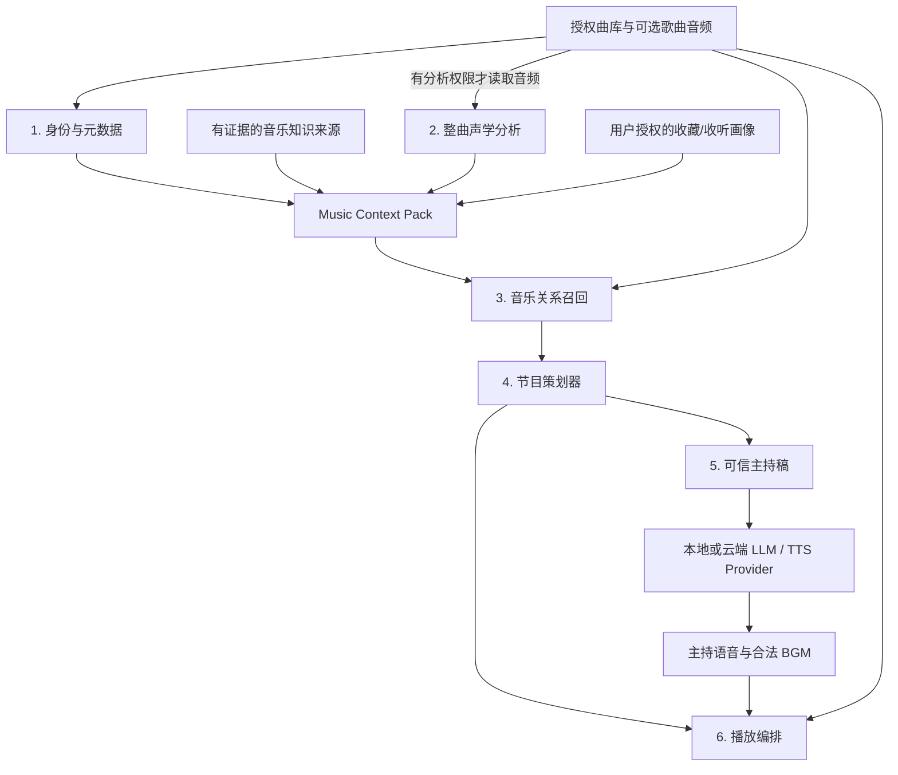

# 概念架构与责任边界

[English](04-conceptual-architecture.md) | 简体中文

**状态：** 本文描述拟议接口和系统责任，尚无对应实现。**只有本文**维护服务器分工、模型选择、音乐信息分层与推荐逻辑。具体 Demo 歌曲不应出现在这里。

## A. 产品与服务分离

先从**授权平台曲库元数据与行为数据**出发，不要求 NAS 或本地音乐文件。目录歌曲、录音身份、听歌统计与合法可播来源是不同对象。音乐知识、本地/云端 LLM/TTS 也应分别配置。

| 职责 | 方向 |
| --- | --- |
| 音乐元数据/行为 | 导入授权平台数据、原始播放次数/添加日期，保留来源 |
| 曲库/播放/基础 AI DJ | **优先验证 Music Assistant + AI Radio** |
| 个人音乐理解 | 拟建 Personal Music Report、可信关系图谱与 Context Pack |
| 节目编辑 | 拟增多个选题、故事线与评论后局部片段改写 |
| Lenovo Smart Storage | 可选后续集成，无已确认音乐 API，不是依赖 |

## B. 音乐信息：身份、知识和声音



### B1. 元数据与可靠音乐知识

**直接从文件/目录读到的：** 音乐人、曲名、专辑/发行、作曲者与参与者（如存在）、年份、时长、编解码、版本标记和目录 ID。标签质量可能较差，单靠文件名无法确保“具体录音”的身份正确。

**统一音乐身份：** `Work`（作品）、`Recording`（具体演唱/演奏）、`Release`（发行）、`Track`（曲库条目）、`ArtistCredit`（音乐人署名）、`PlayableSource`（实际来源）。大型作品中的某个独立章节文件在 v0 仍然是一首完整录音，不做文件内切段。

**联网知识补全：** 在许可范围内读取作品/录音身份、经证实的合作、翻唱关系和有出处的风格/历史背景，并保留来源、可信度、检索日期；**模型的联想不等于历史事实**。

**最低门槛：** 必须能以足够把握识别录音。无法识别或存在严重歧义时提示用户修正或明确报错；缺少封面、年份、部分标签或声学分析不是自动失败条件。

### B2. 声学特征：与元数据严格区分

对于**可合法分析的本地歌曲**，可选的 Analyzer 提取整曲速度/节拍、节奏形态、Chroma/调性置信度、动态和能量变化、音色/频谱摘要、乐器/风格假设及音频 Embedding。每项特征保留算法/模型版本、置信度、分析授权和时间。

这些属于**算法提取的特征**，不是音乐历史事实。“温暖”“忧郁”“吉他质感接近”只能作为听感假设，不允许推导出未经证实的创作影响关系。首版**不做歌曲内部结构定位与自动切片**。

### B3. 个人报告与行为字段

保存 `source_platform, provider_track_id, imported_at, original_date_added, play_count, count_semantics, coverage_start/end, playlist_ids, favorites, matching_confidence, playable_sources`，缺失时不能编造。**导入日期 ≠ 原始添加日期；累计播放次数 ≠ 逐次历史；不同平台次数不可直接相加。** 区分短期洗脑热点与长期收藏/音乐关系中心。

**Personal Music Report** 是可解释、有证据的用户成果；**Context Pack** 只是为本期节目提取的相关证据，不是整库。两者均不要求原始音频。

## C. 从数据到节目

从用户熟悉的音乐出发，依据真实音乐人/作品/音乐史关系准备几个选题（续讲、最近兴趣、意外关联），或接受单曲/主题。TTS 前先规划约 15–20 分钟节目；用户要音乐人关系时不能机械比较多个版本。元数据与合法播放权限分别验证。主持、音乐等按模块渲染；评论优先只调整受影响的片段/串场。记住未展开线索，但不强迫追剧。

## D. 本地/云端模型怎样支持？

以可替换能力接口替代写死某个模型：

- `TextLLMProvider`：`generatePlan(context, constraints)` / `writeScript(plan, sources)`，可配置本地推理端点或用户明确选择的云端服务。
- `TTSProvider`：`synthesize(script, voice, pronunciationHints)`，本地及云端实现输出统一语音资产和时长等元数据。
- `AudioFeatureProvider`：默认在本地以 DSP 或获得允许的本地模型分析；**不假设可以把商业歌曲原音上传云端**。
- `KnowledgeProvider`：从允许使用的音乐数据库或本地缓存获取真实资料；联网查询是与纯本地处理不同的数据/隐私边界。

**规则：** 本地/云端可按能力分别选择，明确显示数据是否出设备、用途、费用与许可。若选定本地模型无法运行，要报错或征得切换同意，**不得静默回退到云端**。Provider 抽象不等于已经证明不同模型效果相当。

## E. 基本数据合同

```json
{
  "recording": {
    "id": "recording:example",
    "work_id": "work:example",
    "release_id": "release:example",
    "credits": ["artist:example"],
    "source_ids": ["local:example"],
    "identity_confidence": "verified"
  },
  "candidate_relation": {
    "from_recording_id": "recording:seed",
    "to_recording_id": "recording:related",
    "relation_type": "shared_performer",
    "evidence_refs": ["source:catalog-entry"],
    "acoustic_observations": [],
    "playability": "local",
    "why_next": "通过可证实的共同演奏者关联两份录音"
  },
  "episode": {
    "target_duration_sec": 900,
    "segments": [
      {"type": "host", "tts_asset_id": "host:intro", "bgm_asset_id": "bed:intro"},
      {"type": "music", "recording_id": "recording:seed", "source_policy": "resolve_at_playback"}
    ]
  }
}
```

分开维护源文件与原始标签、计算得到的声学特征、可信的音乐关系、选择后的节目方案、语音资产和播放视图。用户的曲库事实不应被 AI 生成内容反向覆写；AI 内容可重复生成、标记版本。

## F. 验证顺序

授权导入 Apple Music Windows 或其他数据 → 核对原始播放次数/添加日期 → Personal Music Report → 普通节目与个性化策展对照 → 实测**原版 Music Assistant + AI Radio** → 仅开发测出的缺口。不讨论家庭服务器。

## G. Music Assistant 复用分析（2026-11-18 源码研究）

依据[服务端 dev](https://github.com/music-assistant/server/tree/dev/music_assistant)、[前端](https://github.com/music-assistant/frontend)、[AI Radio](https://www.music-assistant.io/plugins/ai-radio/)公开资料。服务端/前端 Apache-2.0，第三方音源条款和凭据/分发另审。**上游功能不等于本仓库已实现。**

| 上游模块 | 已有职责 | 待验证 |
| --- | --- | --- |
| `controllers/music` | 曲库/数据库/收藏 | API 原始添加日期和播放次数 |
| `controllers/player_queues`、`controllers/streams` | 音频/播放队列 | 合法播放及复用 |
| `providers/apple_music`、`spotify`、`ytmusic`、`neteasecloudmusic`、`qqmusic` | 音源连接 | 个人数据、登录稳定性及授权 |
| `providers/ai_radio/provider.py`、`hosts.py`、`storage.py` | Show/Host 状态 | 复用已有主持/节目基础 |
| `providers/ai_radio/queue_dj.py`、`rendering.py`、`models.py` | 分段 DJ 音轨 | 局部修改及重生成 |
| `providers/smart_playlist`、`sonic_analysis`、`sonic_similarity` | 歌单/声学 | 尽量复用，不当成独创 |
| `providers/openai_compatible`、`openai_tts` | 模型/TTS | 本地/云端和授权 |
| `frontend/src` | Vue/TypeScript UI | API 低保真独立界面 |

AI Radio 仍为 **Alpha**，已经有 Host、Show、TTS、分段口播。未验证的增量：个人行为原始统计、Music Report、跨音乐人有证据的故事、多选题及评论/节目记忆，不能预先断言上游没有。

[Apple Music](https://www.music-assistant.io/music-providers/apple-music/)在 Music Assistant 中的音频播放并非 Apple 官方支持；[网易云](https://www.music-assistant.io/music-providers/netease-cloud-music/)需非官方 API 服务；[QQ 音乐](https://www.music-assistant.io/music-providers/qqmusic/)也需另审授权。导入元数据不等于可抓取/混音 DRM 音频。

