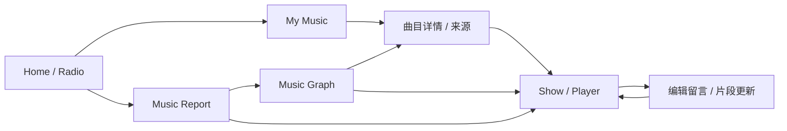

# AI Music Radio — Product Requirements Document

**版本：v0.5 · 2026-11-19 · 数据驱动的真实曲库原型**  
**状态：讨论 / 原型验证，非开发完成**  
**原型：** [基于用户 2025 年度音乐榜单的 H5](../prototype/index.html)  
**数据：** [用户提供截图转录数据（98 首）](../prototype/data/2025-top-songs.json)

## 0. 这份 PRD 解决什么问题

README 解释产品为什么存在、做什么；本 PRD 定义**用户在页面上执行什么操作、系统应当如何响应、数据如何关联、异常如何处理以及怎么验收**。功能稳定 ID / 成熟度继续由 `PRODUCT_FUNCTIONS` 管理；架构文档解释 Music Assistant 哪些服务能够复用。本 PRD 不重复原始代码模块目录。

**核心产品假设：** 用户在平台上积累的收藏、歌单和播放数据本身就是有价值的个人音乐经历。系统应把这些数据转化为可理解的洞察、可核查的音乐关系及有主持人、有策展逻辑的个性化电台，而不仅是“猜你喜欢什么”的歌曲队列。

**本轮重点：** 把原先全部虚构的曲库示例替换为用户提供的 Apple Music「2025年度最爱歌曲」截图，并验证 **My Music → Music Report → Music Graph → Show / Player** 的数据连接和交互闭环。

## 1. 输入资料及真实边界

### 1.1 已有数据

用户提供了 Apple Music「2025年度最爱歌曲」榜单截图。可见 **第 1–98 名**，每行包含排名、曲目名称、音乐人署名及“播放 N 次”。演示数据文件记录这些信息并保留来源。

**数据含义：** `plays2025` 是截图显示的 **2025 年度榜单播放数**，不是 Apple Music 账号的历史累计播放次数，更不是逐次听歌事件。页面显示的 98 条之和为 **1,733**，只代表可见条目播放数之和，不代表完整年度总播放量。名次 99 以后未在这批材料中确认。

**未获得：** Date Added、精确专辑版本 ID、歌词/完整音乐版权、单曲实际时长、每一次播放的时间戳。这些字段在演示 JSON 中应为 `null` 或明确的 unknown。截图中省略号截断的部分歌曲标题 / 署名保留截断并标记 `partial=true`，不可擅自扩写。

**发布说明：** 本次公开仓库仅保存为原型演示所需的用户提供歌名、音乐人、榜单次序、次数及编排；不提交截图、Apple 账号身份信息、原始音乐音频或登录凭据。

### 1.2 观察与推断必须分离

| 层级 | 例子 | 是否可以直接展示 |
| --- | --- | --- |
| **Observed** · 截图可核实 | Red Velvet 6 首入榜、这些条目次数合计 150 | 可以，标明“当前可见榜单条目” |
| **Normalized** · 有据聚合 | 《Hamilton》系列 8 首入榜，合计 169 | 可以，注明根据标题和截图可辨认系列归类，完整版本待核查 |
| **Editorial** · 节目编辑选择 | 把孙燕姿、Queen、方大同放进同一期故事 | 可以，但不得冒充它们有已证实的合作 |
| **Research required** · 外部史实 | 演奏合作、创作影响、版权、具体录音版本 | 查到可核对来源后才显示为事实 |

## 2. 用户角色与应用信息架构

三类用户任务：Music Owner 管理和理解个人数据；Music Explorer 沿音乐人、作品和系列发现关联；Radio Listener 选择节目并连续收听。可以是同一个用户的不同使用状态。

第一轮原型的页面与导航如下：



**页面关系不应是装饰性跳转。** 排名 `#3 Feel My Rhythm` 应在 My Music、Red Velvet 图谱、Report、引用它的节目里都指向同一记录 `t003`。用户修改节目主持词不应修改原始播放次数；数据来源和编辑成果是两种不同数据。

## 3. 功能需求与交互

### FR-01 · Home / Radio：有内容的首页

**用户意图：** 不需要先写 Prompt 就能知道今天有什么值得听的故事。

**页面必须有：** 数据来源与范围、个人音乐的关键观察、至少两个有区别的节目候选，以及进入 My Music / Report / Graph 的入口。

**本轮具体示例：** 98 首可见榜单歌曲；Red Velvet 六首；音乐剧《Hamilton》八首；孙燕姿、Queen、方大同多首作品同时出现。首页应标注“基于 2025 年度榜单截图”，不能写成“你昨天循环了某首歌”，因为没有逐次历史。

**验收：** 点击任何节目候选都进入相应 Show；首页内容与 JSON 中的记录数和分组统计一致。

### FR-02 · My Music：真实曲库和数据完整性

**用户意图：** 查看自己提供的数据，并能检查 AI 是否理解错了歌曲。

**页面必须有：** 按排名的全部可见曲目、歌曲/音乐人名称、2025 播放次数、来源提示、缺失字段提醒、搜索和曲目详情。点击曲目弹出详情层，显示来源、榜单名次、字段置信度与相关图谱 / 节目入口。

**数据合同：**

```json
{
  "id": "t003",
  "rank": 3,
  "title": "Feel My Rhythm",
  "artist": "Red Velvet",
  "plays2025": 35,
  "playCountScope": "2025年度榜单（用户截图）",
  "dateAdded": null,
  "album": null,
  "durationSeconds": null,
  "source": "user_screenshot_2025_favorites",
  "partial": false,
  "audioAvailable": false
}
```

**验收：** 可搜索到 #3《Feel My Rhythm》和 #85《A Hard Rain's A-Gonna Fall》，能看到排名与次数；截断字段有提示；不存在捏造的收藏时间和真实播放按钮。

### FR-03 · Music Report：有依据的个人音乐发现

**用户意图：** 从已有数据看到值得思考或探索的事实，而不是只有流水账或人格标签。

**页面必须有：** 至少三个观察型 Insight、明示数据范围、按主要音乐人聚合的榜单播放统计、进入对应图谱或策展节目的入口。

**本轮洞察：**

- Red Velvet：6 条、150 次（仅这六条 2025 年截图数字相加）。
- 《Hamilton》系列：8 条、169 次，属于“同一作品系列”的整理，不是“音乐人合作次数”。
- 孙燕姿：5 条、70 次；Queen：4 条、47 次；方大同：3 条、47 次。

**异常处理：** 不能基于年度累计数得出“你总在凌晨听歌”或“你某个月突然喜欢某歌”；缺少 Date Added 时报告不得虚构收藏年限。

**验收：** Insight 中的所有数字可从 track IDs 重新计算，点击跳转与节目引用一致。

### FR-04 · Music Graph：完整曲库网络（98 首全部入图）

**用户意图：** “把我年度榜单里的所有歌放进同一张知识图谱。我要看它们与音乐人、作品、音乐剧、以及经过查证的外部知识如何互相连接，而不是只展示某位歌手的一圈歌曲或四条精选线路。”

**P0 全量覆盖（不可降级）：**
- 从 `tracks[]` 中的 **全部 98 条真实歌曲记录**创建稳定 `Track` 节点，每条保留原始排名、2025 播放次数、截图署名及缺失字段；它们都必须出现在**同一全局 SVG**，不能只在侧栏文字列表中出现。
- 每个不同的原始署名文本建立 `SourceCredit` 节点；与其歌曲通过 `observed_credit` 关联。若署名为“等”或被截图截断，只能标识**原样署名字符串**，不可推断完整参与人员。
- 依据现有可辨认的归类增加如 `Hamilton` 的 `Series` 节点，并明确标记“来自截图的策展归类、版本待核实”。
- 将外部核实的音乐知识（音乐人、作品、专辑）作为不同样式节点接入同一图谱，不能把未收藏歌曲当作用户榜单数据。

**关系语义及证据：**
`from, to, type, description, provenance, sourceTitle, sourceUrl`。区分截图中的署名、截图整理出的作品系列归类、公共音乐史出处（演唱合作、制作专辑、专辑收录、成员关系等），后者在图上以虚线显示。**没有历史证据时保留分离的簇，不得编造连线使所有节点强行连通。**

**全图浏览交互（默认模式）：**
1. 首次进入直接显示**包含全部 98 首歌曲**及其署名和外部节点的一张可缩放、可拖动的网络。
2. 搜索歌曲或音乐人并在同一图中定位；放大时显示歌曲名称、原始次数和关联邻居；“全图”恢复所有节点的整体布局。
3. 点击歌曲回到同一个 `Track ID` 的曲目详情；点击音乐人/专辑/外部作品显示其身份和关系；点击任一关系边显示事实说明和可访问的出处。
4. 可以选择 Queen—Bowie—Lou Reed、Bob Dylan—Johnny Cash、Red Velvet—aespa、Sting—The Police 等已查证路径，**仅改变视野焦点，不从 DOM 或数据中删去另外的歌曲**。旧版“按歌手展开”保留为辅助视角。
5. 一份全量曲目索引可帮助手机用户寻找和定位歌曲；不能用索引取代图谱中的真实节点。

**移动端与无脚本保障：** 单个 SVG 允许触控拖动与放大，搜索定位优先；没有 JavaScript 的 iPhone 文件预览仍渲染同一份 98 首歌曲、来源署名和证据关系的静态 SVG，并可点击歌曲锚点跳至完整榜单，不能退回 Red Velvet 六首歌的示例图。

**验收：**
- `count(Track nodes) = 98`、全部榜单 ID 唯一且与 `tracks[]` 一一对应；每首至少有一条可以解释的原始署名关联。
- 能查看四条已核实的外部音乐史关系，并能进入相关策展节目；外部音乐节点与用户曲目严格区分。
- 网络允许断开的事实簇共存；按歌曲搜索和全图显示均可操作。
- iPhone 静态预览中图像不空白，完整榜单仍能显示；未实现真实 AI 播放和历史回填，不得误称其已完成。

### FR-05 · Editorial Planner：基于真实榜单的多节目候选

**用户意图：** AI 像编辑一样提供有针对性的节目，而不是把排行榜按顺序读出来。

**本轮三个节目草案：**

| 节目 | 真实数据起点 | 编辑目标 |
| --- | --- | --- |
| 从《What'd I Miss》回到百老汇舞台 | 《Hamilton》相关曲目 | 围绕同一音乐剧的多首入榜作品策划一个主题故事 |
| Red Velvet 的六个切面 | 六首 Red Velvet 入榜歌曲 | 探索同一音乐人作品的多样性，不等同风格报告 |
| 从《克卜勒》走向《Under Pressure》 | 孙燕姿 / Queen / 方大同等歌手 | 展示跨个人收藏的“编辑并置”，在有研究后再建立真实史实关系 |

**节目数据结构：** Show 引用 `trackIds`、`groupId` 和 `segments[]`；Segment 有 `id`, `type`, `title`, 可选 `trackId`, 以及主持稿 `text`。用户可以对主持稿提出修改。当前节目时长仅是产品规划参考，**缺少真实曲目时长不能声称已经制作出 15–20 分钟成片**。

**验收：** 每个节目可从关联 Insight / Graph 打开；所引用歌曲的榜单数字与 My Music 相同。

### FR-06 · Show / Player：可局部修改的主持节目

**用户意图：** 一边听节目一边像向编辑留言一样改变讲述重心。

**页面必须有：** 节目标题、来源、串联的真实曲目、独立 Intro / Music / Narration / Bridge / Outro 段落、评论输入与改动痕迹。

**本轮行为：** 用户提交“多讲音乐人关系，少讲榜单数字”，原型只重写一个主持 Narration 模拟段落，其他歌曲的 ID、原始次数、其他段落保持不变。该行为是可演示交互，**没有真实 LLM、TTS 或 Apple Music 播放**。

**未来真实实现：** 借助或扩展 Music Assistant `providers/ai_radio` 的 Host/Show/Segment、Queue DJ 和 TTS 渲染能力；实际做到哪些局部修改必须在原版插件上实测。

**验收：** 一次评论可定位并改变指定段落；节目引用的原始数据保持只读；播放器明确说明是模拟状态而不是假装播放商业歌曲。

## 4. Music Assistant 复用边界

| 我们的产品层 | Music Assistant 复用候选 | 需要我们补充 / 验证 |
| --- | --- | --- |
| Music Data | 音乐 Provider、曲库接口 | **外部历史榜单导入、原始统计字段来源与质量** |
| Unified Library | `controllers/music`、曲目和歌单检索 | 个人源记录 ID / 跨平台记录映射 |
| Personal Report & Graph | 现有统计/推荐及部分声学能力 | **音乐关系语义、证据、可解释个人报告和图谱 UI** |
| Editorial Planner | AI Radio Show/Host 基础 | **多选题、事实核查、长篇叙事和 Context Pack** |
| Radio Production | `providers/ai_radio/queue_dj.py`、`rendering.py`、音频/队列 | 评论后局部编辑、真实音乐授权与时长 |
| Product UI | Vue 前端 / API | 按完整用户旅程检验是复用原 UI 还是独立前端 |

目前只是基于公开源码的评估候选，不代表已经连接。模型与数据可使用用户授权的本地或云端 Provider，不把运行位置设计成产品身份。

## 5. 状态、异常与数据保障

1. **字段缺失：** Date Added / Album / Duration 为 unknown；不得当作零或今天。
2. **榜单截断：** 用 `partial=true` 标记，用户可进一步核对；UI 不猜补完整署名。
3. **未提供播放权限：** 允许报告和节目草案，不提供假音轨；模拟播放按钮明确说明无声音。
4. **真实关系不足：** 可展示“同音乐人”“同系列”“节目引用”；音乐史合作、影响等关系须有另行可核实资料。
5. **脚本不运行：** 静态 HTML 中仍能看到 Music Report、SVG 图谱、98 条榜单记录和节目候选；交互功能可在普通浏览器使用。
6. **个人信息范围：** 公开原型仅包含用户明确要求采用的榜单字段，不包含账号、截图、Cookie 或整套 Apple Music 历史。

## 6. MVP 验收与后续阶段

**演示原型应通过：** `rank 1..98` 唯一且连续；榜单播放次数之和为 1,733；核心音乐人聚合与 `trackIds` 重新计算一致；图谱节点到曲目、曲目到节目均能跳转；评论只修改主持 Segment；桌面及手机浏览可操作；无 JS 页面不会空白。

**尚未通过产品级验收：** 真实数据自动获取/同步、音乐史事实核查管线、跨平台身份识别、真实 LLM / TTS、歌曲播放授权、有效时长编排、Music Assistant API 联调。它们仍需分别实施和测试。

下一步应重点研究：Apple Music Windows 真实导出是否能获得完整播放次数与原始添加日期；Music Assistant 现有统计是否接收外部数据；如何引入经过核对的音乐人合作与署名知识；AI Radio 能否消费我们策划的时间轴。

**文档维护规则：** 本 PRD 管用户交互与验收；`PRODUCT_FUNCTIONS` 管功能 ID / 状态；`04-conceptual-architecture` 管底层实现与复用。不要再让 README 变成只有链接的空壳，也不复制整张功能库到每一页。
